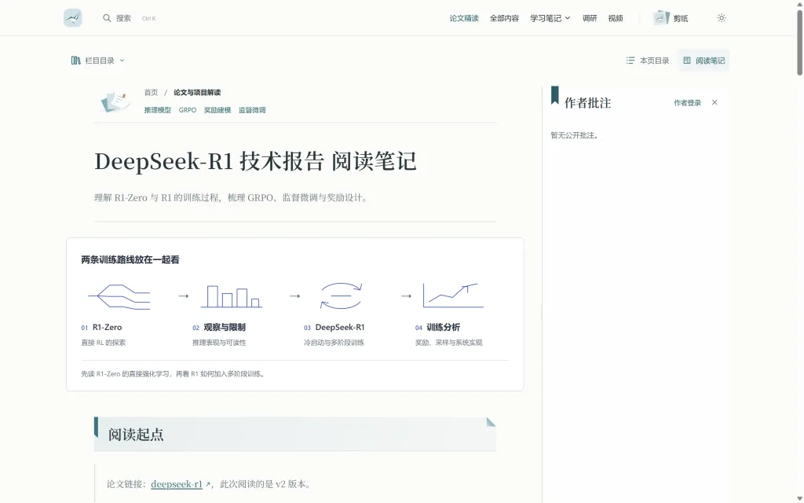
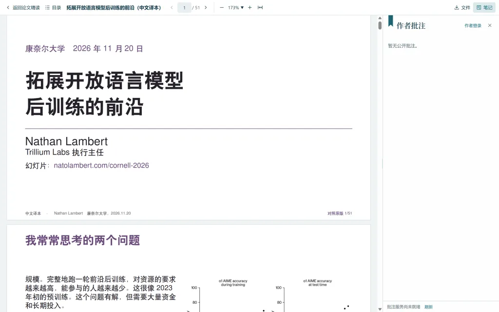
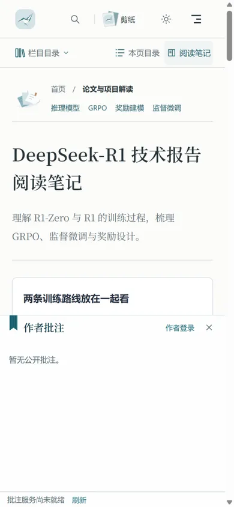
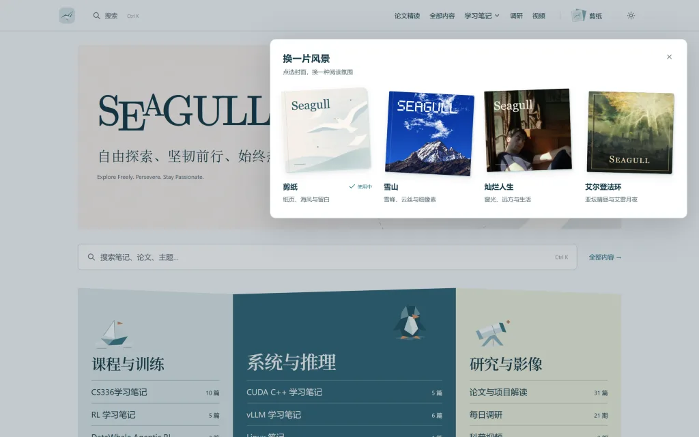
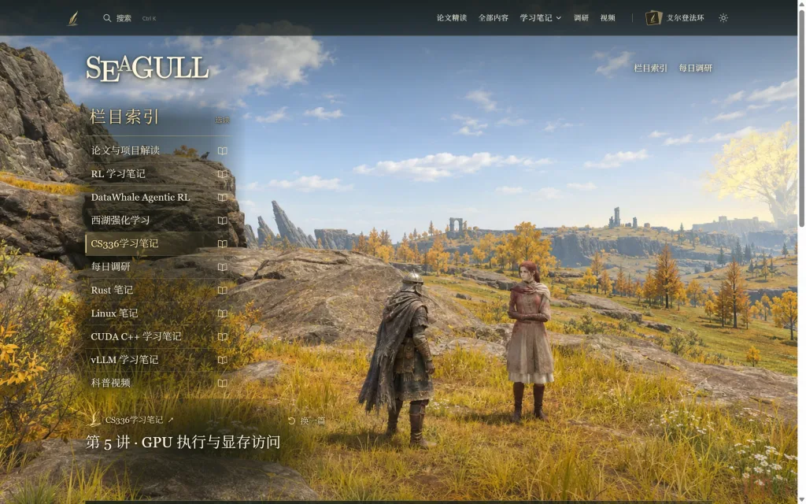
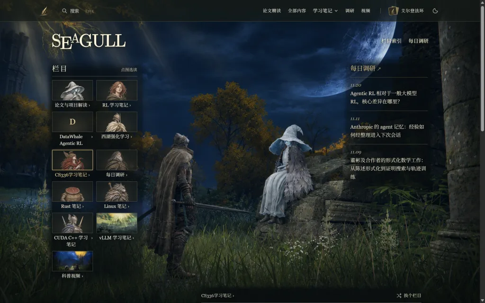

  <a href="https://seagull-llm.pages.dev/">
    <picture>
      <source media="(prefers-color-scheme: dark)" srcset="docs/public/images/home/closing/paper-tide-night.webp">
      
    </picture>
  </a>

<h1 align="center">Seagull 的学习主页</h1>

我在这里记录大模型与强化学习的课程实验、读论文时留下的批注，以及值得单独追下去的问题。

  <strong><a href="https://seagull-llm.pages.dev/">进入网站</a></strong> ·
  <a href="https://seagull-llm.pages.dev/tags">按主题浏览</a> ·
  <a href="https://seagull-llm.pages.dev/research/">阅读每日调研</a>

## 网站-批注功能

### 把批注放在原文右侧

读网页文章或 PDF 时，我可以选中一句话，也可以在「框选」模式下拖框圈出图表、公式或幻灯片中的任意区域，写下当时的疑问（支持 Markdown 与 LaTeX 公式）。公开后，读者点原文里的标记就能展开批注，也能从批注卡片跳回对应段落或图表；无公开批注时面板默认收起，保持正文居中阅读。

| 场景 | 定位与交互方式 |
| --- | --- |
| **网页文章（PC）** | 选中文本按上下文锚定，或开启工具栏「框选」直接圈选图表区域；右侧停靠面板与原文并排对照 |
| **PDF 论文 / 幻灯片（PC）** | 内置 `pdf.js` 阅读器，按页码与归一化区域坐标定位，支持文字高亮、区域框选裁切与页面书签 |
| **手机端阅读** | 底部固定批注抽屉，上方为原文与输入法键盘保留可视空间，对照阅读不遮挡当前行 |
| **数据与同步** | Cloudflare Pages Functions 读写 D1 数据库；读者端公开只读，作者登录后自动离线排队同步 |

<table>
  <tr>
    <td align="center" width="50%">
      
       <b>PC 端 · 网页正文批注</b>（右侧停靠面板，与原文同屏对照）
    </td>
    <td align="center" width="50%">
      
       <b>PC 端 · PDF 论文与幻灯片批注</b>（支持页码跳转、缩放、目录与区域框选）
    </td>
  </tr>
</table>

  
   <b>手机端 · 底部固定批注面板</b>（为原文与输入法保留阅读空间）

> 代码入口：[批注组件](docs/.vitepress/components/AnnotationNotebook.vue) · [PDF 阅读器](docs/.vitepress/components/PdfViewer.vue) · [存储与访问接口](server/notes-api.ts)

## 四套视觉风格

全站正文共用同一套学术阅读版式（本地 Noto Serif SC 宋体、720px 版心、等宽数字表格），点击顶栏的风格封面即可打开「换一片风景」手册，在四套主题间切换，昼夜模式独立保存。[视觉规范](VISUAL_STYLES.md)

<table>
  <tr>
    <td align="center" width="50%">
      
       <b>剪纸 · Paper Coast</b> — 折纸分册地图、跨栏选读与月刊式每日调研
    </td>
    <td align="center" width="50%">
      
       <b>雪山 · Pixel Voyage</b> — 钴蓝雪峰、像素栏目图标与卷尾太刀遭遇战
    </td>
  </tr>
  <tr>
    <td align="center" width="50%">
      
       <b>灿烂人生 · Along the Way</b> — 保留电影原帧比例与胶片接触印相索引
    </td>
    <td align="center" width="50%">
      
       <b>风格手册 · 换一片风景</b> — 四套封面实时预览，支持键盘方向键切换
    </td>
  </tr>
  <tr>
    <td align="center" width="50%">
      
       <b>艾尔登法环 · Grace Archive（昼）</b> — 亚坛高原晴昼与暗金栏目选单
    </td>
    <td align="center" width="50%">
      
       <b>艾尔登法环 · Grace Archive（夜）</b> — 艾雷教堂月夜、人物藏品格与每日调研
    </td>
  </tr>
</table>

## 自动调研与站点构建

### 自动调研

自动调研脚本从 arXiv、Hugging Face Papers、研究博客和开源项目的发布记录中收集新材料，按主题和时间窗口筛选、去重。Codex 根据资料生成带出处的初稿，我读过并反馈后再定稿。脚本可以把定稿加入「每日调研」目录，构建网站并检查发布后的页面。[订阅配置](research/workflow.json) · [调研流程](research/daily.md)

### 存放笔记

VitePress 将 Markdown 和 HTML 正文构建为静态页面，Vue 组件提供 PDF 阅读器和批注面板。想沿着一门课读，可以跟随栏目侧栏；想找同一主题下的课程笔记、论文和调研，可以从标签页进入。网站部署在 Cloudflare Pages。[站点配置](docs/.vitepress/config.mts) · [阅读组件](docs/.vitepress/components/)

## 从哪里开始读

| 感兴趣的方向 | 阅读入口 |
| --- | --- |
| 从零实现大模型，跟着讲义做作业和 GPU 实验 | [Stanford CS336 学习笔记](https://seagull-llm.pages.dev/cs336/) |
| 学习强化学习的数学推导、奖励建模与训练实践 | [西湖强化学习](https://seagull-llm.pages.dev/westlake-rl/) · [强化学习笔记](https://seagull-llm.pages.dev/rl-book/) |
| 对照 R1-Zero 和 R1 的训练过程，读懂奖励设计 | [DeepSeek-R1 阅读笔记](https://seagull-llm.pages.dev/papers/deepseek-r1/) · [更多论文与项目](https://seagull-llm.pages.dev/papers/) |
| 理解一次 rollout 的算力花在哪里 | [一条训练样本值多少 token](https://seagull-llm.pages.dev/research/2026-10-28-rollout-compute-economics) |
| 从代码理解并发，从操作系统理解隔离 | [Rust 笔记](https://seagull-llm.pages.dev/rust-notes/) · [Linux 笔记](https://seagull-llm.pages.dev/linux-notes/) |
