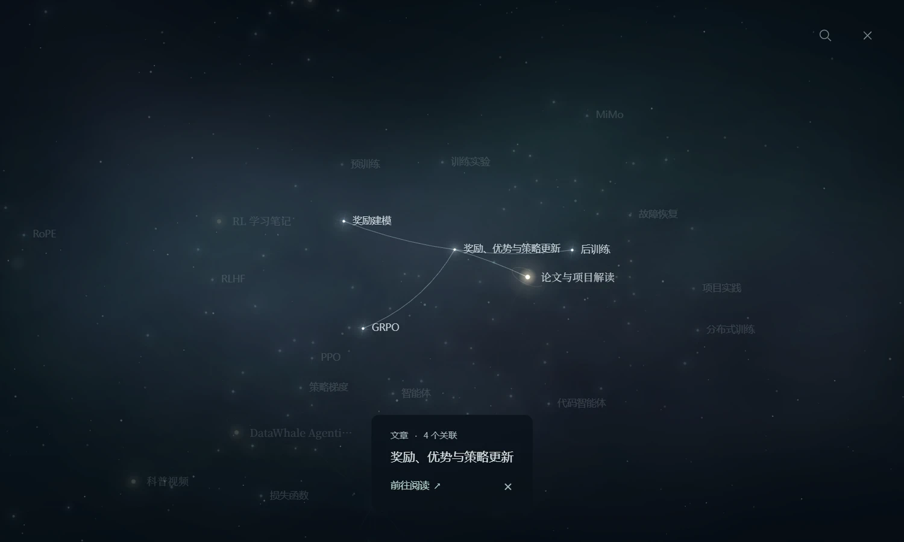
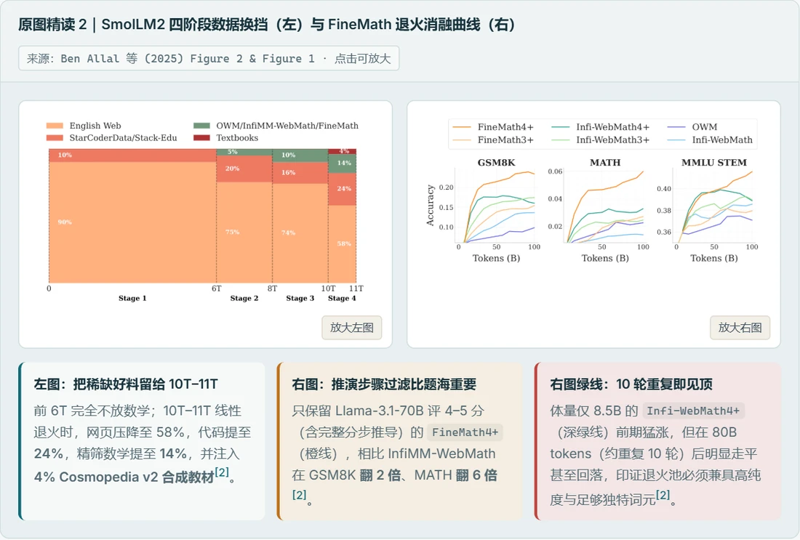
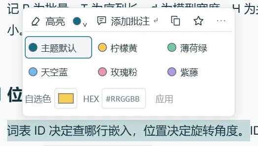
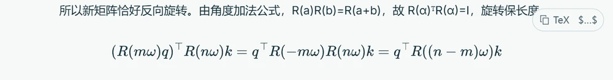
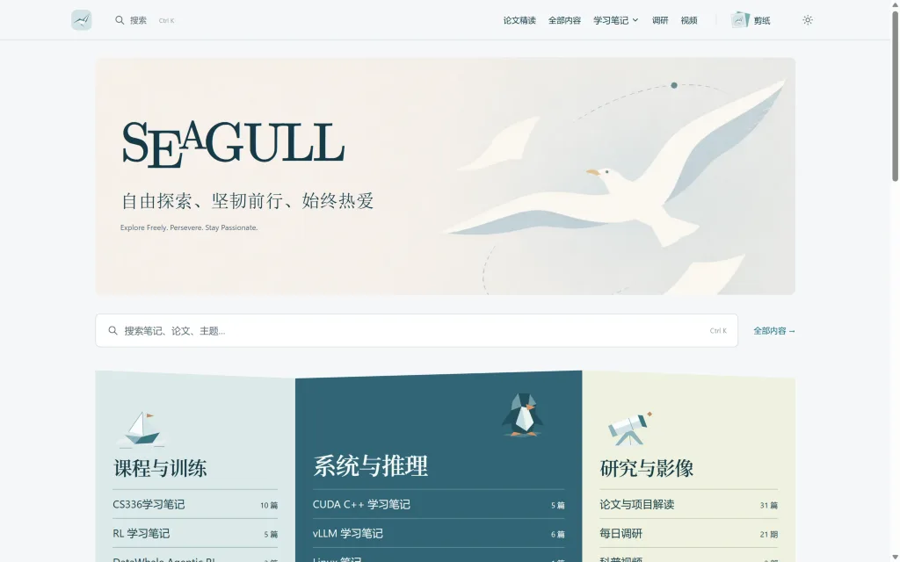
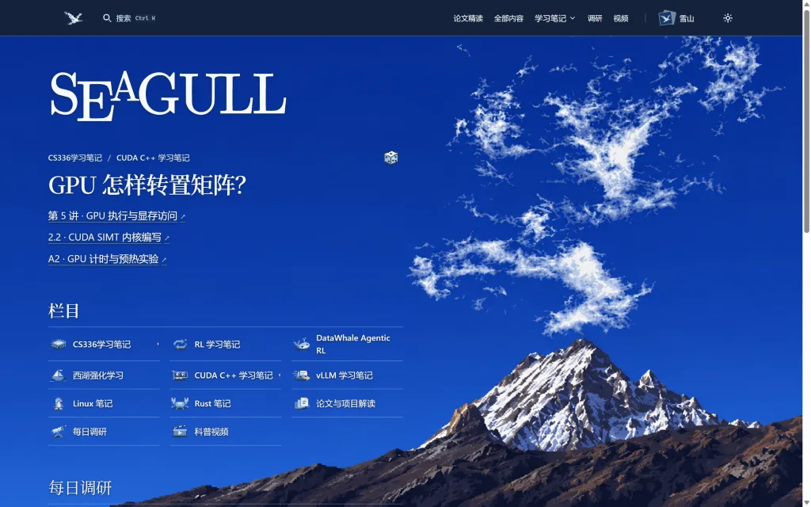
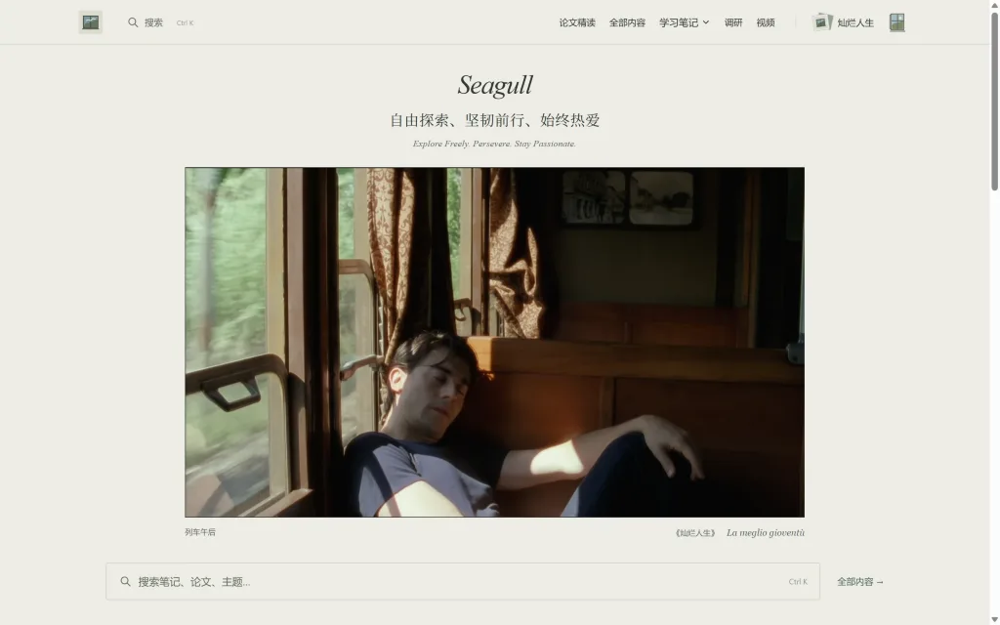

<p align="center">
  <a href="https://seagull-llm.pages.dev/">
    
  </a>
</p>

<h1 align="center">Seagull 的学习主页</h1>

<p align="center">我在这里记录大模型与强化学习的课程实验、读论文时留下的批注，以及值得单独追下去的问题。</p>
<p align="center">
  <strong><a href="https://seagull-llm.pages.dev/">进入网站</a></strong> ·
  <a href="https://seagull-llm.pages.dev/tags">按主题浏览</a> ·
  <a href="https://seagull-llm.pages.dev/research/#精选调研">精选调研</a>
</p>

## 从哪里开始读

| 想弄清的问题 | 可以从这里开始 |
| --- | --- |
| 怎样从头实现一个 Transformer，再测出它在 GPU 上跑一步需要多久？ | [CS336 · 从 RoPE 到 Transformer 块](https://seagull-llm.pages.dev/cs336/a1-transformer) · [GPU 计时与预热实验](https://seagull-llm.pages.dev/cs336/a2-benchmark) |
| 奖励怎样影响策略更新？DeepSeek-R1 又怎样为推理任务设计奖励？ | [西湖强化学习讲义](https://seagull-llm.pages.dev/westlake-rl/) · [DeepSeek-R1 技术报告阅读笔记](https://seagull-llm.pages.dev/papers/deepseek-r1/) |
| GPU 内核怎样访问显存？推理引擎怎样算出能放多少 KV Cache？ | [CUDA · SIMT 内核与合并访存](https://seagull-llm.pages.dev/cuda-notes/simt-kernels) · [vLLM · KV Cache 配置源码](https://seagull-llm.pages.dev/vllm-notes/kv-cache-config) |

## 沿着知识星图找文章

打开网站顶栏的「星图」，按 `/` 搜索「奖励」，选中《奖励、优势与策略更新》。亮起的连线通向这篇文章所属的栏目和主题。点「前往阅读」打开正文，或选中相邻的主题，继续找同一问题下的其他笔记。

[](https://seagull-llm.pages.dev/atlas)

知道关键词时，顶栏搜索可以直接查正文。想缩小阅读范围，可以在主题索引里叠加栏目、内容类型和「幼苗／成长／常青」成熟度筛选。[打开全屏知识星图](https://seagull-llm.pages.dev/atlas) · [浏览「强化学习」主题](https://seagull-llm.pages.dev/tags#强化学习)

## 精选调研 · 0.5B–3B 小模型预训练

SmolLM2 在训练的哪个阶段增加数学语料？这样做对推理成绩有什么影响？下图取自文章的数据配方一节。左图追踪四个阶段的语料配比，右图比较退火时换用不同数学语料的结果。顺着正文往下读，可以对照各阶段的评测表，再回到论文原图核查。

[](https://seagull-llm.pages.dev/research/2026-11-27-slm-pretraining-2026#h-data)

[从「数据配方」一节开始读](https://seagull-llm.pages.dev/research/2026-11-27-slm-pretraining-2026#h-data) · [进入每日调研，可切换「仅看精选」](https://seagull-llm.pages.dev/research/)

## 对着原文读批注

我读网页时可以选中一句话、选高亮颜色，或用 Markdown 和 LaTeX 写批注。读 PDF 时也可以框住一张图，把问题留在对应页。批注公开后，读者点原文标记就能展开，也能从卡片回到当时选中的句子或图表。

<table>
  <tr>
    <td width="50%" valign="top">
      
      <br><sub><b>网页选句</b> · 把对准确性奖励和格式奖励权重的疑问留在原句旁。</sub>
    </td>
    <td width="50%" valign="top">
      
      <br><sub><b>PDF 框选</b> · 点批注里的页码，回到区分训练算力与测试算力的两幅图。</sub>
    </td>
  </tr>
</table>

上面两条批注是本地操作示例。文中带 TeX 源码的公式也可以直接复用，指向公式后点「TeX」即可复制，点「$…$」会连同定界符一起复制。[打开 RoPE 推导](https://seagull-llm.pages.dev/cs336/a1-transformer#derive) · [翻到讲义第 2 页](https://seagull-llm.pages.dev/papers/lambert-cornell-2026/#page=2)

<details>
<summary>查看选色、公式复制和手机批注面板</summary>

<p><b>网页高亮</b><br>
</p>

<p><b>复制公式</b><br>
</p>

<p><b>手机阅读</b> · 批注在底部抽屉中展开，上方保留原文。<br>
</p>

</details>

## 四套视觉风格

点顶栏的风格封面打开「换一片风景」，可以切换首页和阅读界面的风格。昼夜模式可单独设置。[视觉规范](VISUAL_STYLES.md)

<table>
  <tr>
    <td width="50%"><br><sub><b>剪纸 · Paper Coast</b>　折纸分册与海岸</sub></td>
    <td width="50%"><br><sub><b>雪山 · Pixel Voyage</b>　像素雪峰与栏目地图</sub></td>
  </tr>
  <tr>
    <td width="50%"><br><sub><b>灿烂人生 · Along the Way</b>　电影原帧与胶片索引</sub></td>
    <td width="50%"><br><sub><b>艾尔登法环 · Grace Archive</b>　亚坛高原与暗金选单</sub></td>
  </tr>
</table>

## 本地运行与实现

<details>
<summary>运行网站、查阅代码与调研流程</summary>

在仓库根目录运行以下命令，然后打开终端显示的本地地址。本次构建使用 Node.js 22.23.3。

```sh
npm ci
npm run dev
```

用 `npm run build` 生成静态站点，`npm run preview` 预览构建结果。VitePress 将 Markdown 和 HTML 构建为页面，Vue 组件负责星图、PDF 阅读和批注。线上批注通过 Cloudflare Pages Functions 与 D1 存取，本地静态预览可用于浏览正文和星图。[站点配置](docs/.vitepress/config.mts) · [知识星图](docs/.vitepress/components/KnowledgeAtlas.vue) · [PDF 阅读器](docs/.vitepress/components/PdfViewer.vue) · [批注接口](server/notes-api.ts)

调研时，Hermes 传递原始问题并调度，Codex 核对原文并留下带出处的笔记，Antigravity 据此编排图表和 HTML 初稿。我审阅、反馈后决定发布。[协作约定](hermes/README.md) · [调研流程](research/daily.md)

</details>

## 许可协议

- **原创代码**采用 MIT 许可。分发代码副本或实质性部分时须保留版权与许可声明。[MIT 全文](LICENSE)
- **原创文章**采用 CC BY 4.0。转载、翻译或改编时请注明作者、原文链接和许可，并标明改动。[协议全文](licenses/CC-BY-4.0.txt) · [官方中文说明](https://creativecommons.org/licenses/by/4.0/deed.zh-hans)
- **第三方材料**按各自的授权使用，包括论文、课件、引用图表、影视与游戏画面、字体和第三方代码。请查阅文件、图注或原始来源中的声明。[CS336 作业一许可](docs/public/cs336/sources/assignment1/LICENSE) · [作业二许可](docs/public/cs336/sources/assignment2/LICENSE) · [Noto Serif SC 字体许可](docs/.vitepress/theme/fonts/OFL-NotoSerifSC.txt)
