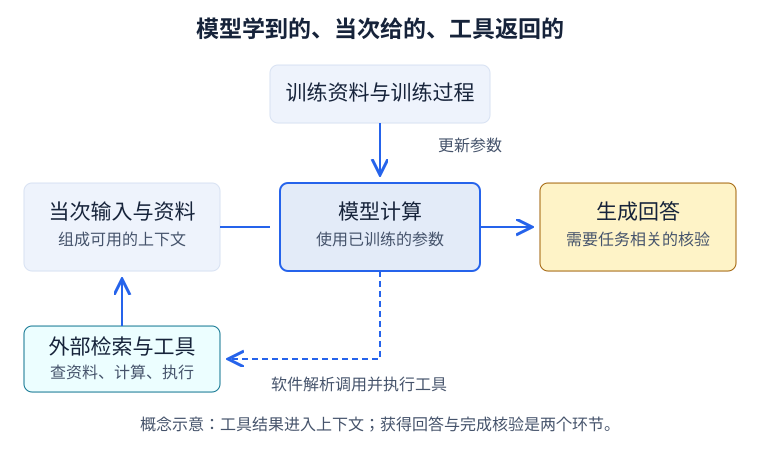
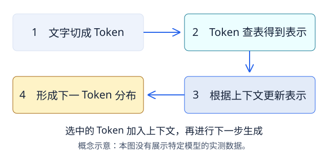
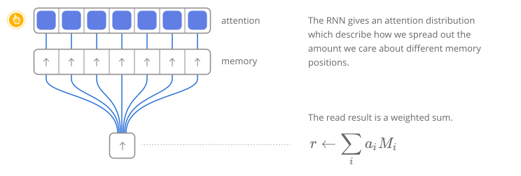

# 一次回答是怎样生成的

## 本章导引

> 你输入一个问题，屏幕上很快出现了回答。中间发生了什么？本章沿着文字进入模型、变成表示、形成候选分布的过程走一遍。读完后，你应该能解释一次生成步骤，并区分“模型怎样生成”和“回答有没有依据”。

::: info 重构样章
这里以自回归、基于 Transformer 的文本模型为例。交互中的切分、向量和概率都是教学示意，没有运行真实模型；真实资源的入口在章末。
:::

## 先分清：模型学过的，与这次输入的

假设你问：“本学期普通周的周三，图书馆几点闭馆？”一个对话产品可能把你的问题、先前的对话、任务指令和找到的资料一起交给模型。**这些当次可用的信息构成上下文。** 工具能否联网查到安排，还取决于产品提供了什么工具，以及软件有没有执行检索。

模型本身则使用训练中学到的参数处理输入。参数是控制计算的数值；训练会依据数据与学习目标调整它们。通常的一次推理使用已有参数，不会因为你在输入里写了一条新安排，就立刻把它写进模型的参数。预训练、上下文学习和后训练的区别，在专业教材中有进一步说明。[1]

这张图先帮我们区分信息的来路。关于“图书馆几点闭馆”，模型可能依据已有模式生成一个答案，也可能利用你提供或工具查到的安排。仅看一句流畅的回答，无法确定它采用了哪一种依据。

## 从文字到候选，走一遍生成步骤

先用一个更短的输入：“今天天气”。接下来可能是“晴朗”，也可能是“阴沉”。这个例子只帮助理解生成步骤，并没有查天气。

点击阶段按钮逐步观察；到第四步时，换一个第一步候选，比较后续分布。

<ClientOnly>
  <GenerationWalkthrough />
</ClientOnly>
<noscript>
  
静态步骤图：文字切分后，依次经过表示、上下文处理与候选分布；选中的 Token 加入下一步的上下文。

  
</noscript>

### 文字先变成离散单元

分词器把文本转换为 Token 序列，再将 Token 对应到编号。Token 是具体词表中的离散单元：它可能对应完整词、词的一部分、标点、字节片段或特殊标记。切分依赖分词器，不能把“介于字与词之间”当成所有 Token 必须满足的大小关系。[2]

演示把“今天天气”分成“今天 / 天气”，是作者设定的示意。需要检查某个模型的实际切分时，应记录模型或分词器版本；已有的[分词演示](../ch02-tokenization#_2-3-亲手试试-交互演示)可以用来观察不同方式的差异。

### 编号变成一组数字

模型需要数值表示。一个常见做法是：用 Token 编号从嵌入表中取出一个向量。向量可以先理解为一组数字，比如演示中的 `[0.2, 0.7, 0.1, …]`；真实模型中的长度和数值由模型设计与训练决定。

这些坐标通常没有预先写好的语义标签。随后，网络会根据可用上下文更新表示，所以同一个 Token 在不同句子中的内部表示可以不同。初始查表表示与后续上下文表示，需要分开理解。[1]

### 网络处理上下文

在 Transformer 中，注意力计算让当前位置按权重汇总来自其他位置的信息，前馈网络等计算继续变换表示。多个这样的层依次处理数据。自回归生成模型的因果遮罩限制每个位置使用后面的 Token；原始 Transformer 还包含编码器与解码器之间的注意力，和这里的简化地图需要区别。[3]

::: details 从网络图解理解“加权汇总”

图：Chris Olah、Shan Carter，[Attention and Augmented Recurrent Neural Networks](https://distill.pub/2016/augmented-rnns/)，2016；[CC BY 2.0](https://creativecommons.org/licenses/by/2.0/)，原图未修改。

可以沿着连线看：多个向量按不同权重参与一个汇总结果。原文用它解释神经图灵机怎样读取外部记忆；这里借它建立“加权汇总”的直觉。它不是 Transformer 架构图，也没有展示某个 LLM 的实测注意力。关于当前生成模型中的具体计算，可以继续看章末的 Transformer Explainer。
:::

注意力是网络中的一类运算。知道这类运算怎样计算，并不等于已经解释了模型为什么形成某个具体结论；不要把图中的一条粗线直接读成它完整的推理理由。

### 从候选分布选择，再继续

最后位置的表示可以转换为词表中各候选的分数，再转换为概率。解码策略决定怎样选择下一个 Token：例如选择最高分候选，或按调整后的分布抽样。被选中的 Token 加入已有序列，后续步骤以这个更长的上下文为条件。[4]

因此，“形成分布”和“作出选择”是两个环节。一个位置上的高概率，也不直接代表关于世界的结论已经获得事实证据。

演示只安排了三个虚构候选，选择后切换到另一组预设数字。真实模型要处理完整词表，经过多层数值计算得到分布；动画帮助观察条件变化，没有模拟这套完整计算。

## 这张生成地图能解释到哪里

它解释了文本怎样一步步产生。它还提示我们两个需要另行检查的问题：上下文有没有足够的资料，生成结果有没有正确使用资料。

“预测下一 Token”描述学习目标或生成机制的一个重要方面。模型是否能完成某种推理任务，应通过任务表现、测试条件和失败情况来考察；这个短语本身不足以裁定模型的全部能力。

真实推理实现还可能复用先前的键和值，以减少重复计算。缓存怎样影响延迟和成本，可以在推理效率专题中展开；这里的循环图只表示信息依赖，不要求每步都把全部输入从头重算。[4]

## 换个例子，检验理解

回到图书馆问题。模型生成了“周三 23 点闭馆”。你能仅凭本章的生成步骤判断它答对了吗？如果把正确的开放安排放进上下文，又能保证回答一定正确吗？

::: details 思考后的参考解释
还需要比较回答与适用的安排。生成过程说明答案怎样产生，没有证明答案正确。提供资料改变了模型可用的信息，但仍需检查它是否忽略资料、选错日期范围或错误引用。[5] 下一章会把这些检查拆成可观察的步骤。
:::

再解释一个区别：聊天中“记住了我的要求”，可能是因为要求还在上下文中，也可能是产品存储后再次提供。需要先检查产品的信息流，才能判断这里的“记住”指什么。

## 本章小结

- 训练调整参数；通常的一次推理使用已有参数处理当次上下文。
- 文本经过分词、数值表示和网络处理，形成下一 Token 的候选分布。
- 选择的 Token 加入后续上下文；选择方式会影响生成路径。
- 生成机制与事实核验相互关联，可靠性仍需任务相关的检查。

## 参考文献与进一步阅读

1. Jurafsky、Martin，[Speech and Language Processing](https://web.stanford.edu/~jurafsky/slp3/)，2026 在线稿；表示、Transformer 与预训练、后训练章节。用于校对训练、上下文和表示的区别。
2. Hugging Face，[Tokenization algorithms](https://huggingface.co/docs/transformers/main/tokenizer_summary)，核验于 2026-10-09。用于比较词、字符、子词与字节级方案。
3. Vaswani 等，[Attention Is All You Need](https://arxiv.org/abs/1706.03762)，2017，§3。用于了解注意力、遮罩、前馈网络和原始架构。
4. Jurafsky、Martin，[Transformers and Pretraining](https://web.stanford.edu/~jurafsky/slp3/7.pdf)，2026-08-19 在线稿，第 7 章。进一步了解输出、解码、预训练与缓存。
5. Huang 等，[A Survey on Hallucination in Large Language Models](https://arxiv.org/abs/2311.05232)，2023，修订于 2024。进一步了解错误来源与检索增强系统的局限。

想观察真实模型，可以打开 [Transformer Explainer](https://poloclub.github.io/transformer-explainer/)：它提供浏览器中的 GPT-2 交互，使用自己的文本查看内部组件与生成。界面主要为英文，模型需要加载；其结果描述 GPT-2 的具体实现。[作者介绍与源码](https://github.com/poloclub/transformer-explainer)

想先看连贯图解，可阅读 [3Blue1Brown 的 GPT 解释](https://www.3blue1brown.com/lessons/gpt/)；图与动画的采用方式见[视觉资源记录](./visual-resources)。
