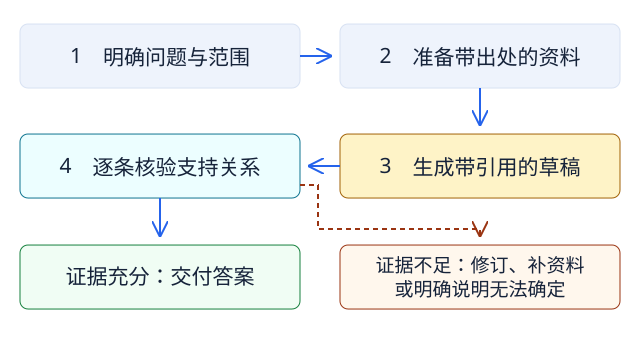

# 带引用的回答，怎样才算有依据

## 本章导引

> 你让模型依据资料回答，得到了一段带引用的文字。接下来该检查什么？本章用三份简短资料追踪结论和出处的关系。读完后，你应该能发现错位引用，说明资料缺口，并设计一个在交付前检查草稿的简单流程。

::: info 重构样章
下面的图书馆、通知、日期范围、草稿和核验结果都是虚构教学例子。交互脚本展示预设情形，没有调用模型，也不是一个能自动判断任意事实的核验器。
:::

## 先看一段貌似有依据的回答

问题是：“本学期普通周的周三，图书馆几点闭馆？普通阅览区域需要预约吗？”

现有三份资料：

| 编号 | 资料 | 内容 |
|---|---|---|
| A | 普通周开放安排 | 普通教学周，周一至周五 08:00–22:00 开放 |
| B | 考试周延时通知 | 仅考试周的周一至周五，延长至 23:00；其他日期沿用普通安排 |
| C | 区域预约规则 | 安静自习室需预约；普通阅览区域无需预约 |

草稿写道：

> 普通周周三，图书馆 23:00 闭馆。[B] 所有阅览区域都需要预约。[C]

先自己检查一次：引用的资料是否存在？资料真的支持旁边的结论吗？结论有没有扩大适用范围？

## 跟着结论查出处

在下面选择“引用错位”，推进到核验步骤。再比较“修正后”和“资料不足”：同一句答案在资料改变后，能否继续成立？

<ClientOnly>
  <EvidenceWalkthrough />
</ClientOnly>
<noscript>
  
静态步骤图：明确问题后准备资料，生成草稿并逐条核验；资料不支持结论时，修订、补资料或明确未知。

  
</noscript>

本例中的第一条引用存在，日期范围却错了：B 适用于考试周，问题问的是普通周。第二条把 C 的“安静自习室”扩大成“所有阅览区域”，还忽略了普通区域无需预约的说明。

**检查引用时，要同时检查来源和支持关系。** 来源存在、来源可靠、来源支持这句话，是分别需要回答的问题。生成内容与给定来源是否一致，属于忠实性检查；来源本身是否准确、完整、及时，还需要另外判断。[1]

## 资料缺失时，应当改变什么

切换到“资料不足”，C 不再可用。现在仍能依据 A 回答普通周周三 22:00 闭馆；A、B 都没说预约规则，因此不能用它们确认是否需要预约。

合理的处理包括补充资料，或者交付范围有限的答案：“普通周周三 22:00 闭馆；现有资料没有预约规则，无法确定普通阅览区域是否需预约。”这句话把已支持的结论与未解决的问题分别说清楚。

不能因为上一轮回答过这个问题，就忽略这一轮的证据缺口。实际任务中还可能出现文件版本冲突、过期规定、检索漏掉材料或错误转述，需要按任务检查。检索增强可以给模型提供外部信息，但检索成功并不直接保证生成忠实于来源。[1][2]

## 从这次检查，设计一个简单工作流

把“依据资料回答”拆成四个有可检查输出的步骤：

| 步骤 | 要产出什么 | 怎样检查 |
|---|---|---|
| 明确问题 | 时间、对象、任务与期望答案范围 | 普通周还是考试周？哪一种区域？条件不清先补足 |
| 准备资料 | 原出处、版本、适用条件与相关片段 | 检查资料是否对应当前问题，关键材料是否缺失 |
| 形成草稿 | 可以逐条核查的结论与对应出处 | 每条关键结论都能找到对应材料，资料没说的内容明确标出 |
| 核验与交付 | 修订后的答案，以及剩余缺口 | 比较结论与原文，核查范围；证据不足时停下或限制答案 |

这里的流程由预先设定的步骤组织，是一个固定工作流。若让模型根据任务进展动态决定查什么、调用什么工具、怎样继续，则增加了 Agent 的决策部分。[3] 两种组织方式需要按任务选择；流程图本身不能保证结果正确。

为了让流程有边界，可以先设定：资料不足时补充检索一次；仍无法支持的结论改写为未知；涉及资料冲突的情况交给人判断。重试次数、交付标准与人工判断点，都应随具体任务确定。这个例子展示的是一种设计办法。

## 怎样知道改进有效

只观察普通周这一题，还不足以判断流程能否适应变化。给这个虚构任务准备几种不同情况：

- 换成考试周，检查是否正确采用 B 的适用条件。
- 换成安静自习室，检查是否保留 C 的区域区分。
- 移除 C，检查能否指出预约信息缺失。
- 加入一份过期安排，检查是否核对版本和日期。

分别记录结论是否正确、引用是否支持、缺口是否明确，以及是否遵守重试和人工判断条件。先用直接回答作为基线，再比较加入资料与核验后的结果。复杂任务还需要更系统的数据、指标和评估方法，不能把这几题的结果推广成模型的通用准确率。[4]

## 换到你的专业领域

把图书馆安排换成课程规定、产品说明、实验手册或公开研究资料，检查关系仍然相同：问题问了什么条件，材料适用于什么条件，结论有没有得到支持。

试着画一个自己的流程：输入是什么；需要哪些资料；模型生成什么；谁检查、根据什么检查；何时补资料，何时说明无法确定。资料解释需要专业知识时，流程中的检查者也需要相应知识。

::: details 自检提示
如果流程只有“让模型回答，再让模型确认正确”，还需要补具体核验依据。另一轮生成可以协助发现问题，但应说明它能访问什么证据，检查哪种错误，仍有哪些结论需要查原文或人工判断。
:::

## 本章小结

- 带引用的回答仍需检查来源、支持关系和适用范围。
- 缺少关键资料时，补充资料或明确未知，不能用无关出处填补缺口。
- 把问题、资料、草稿与核验拆成可检查的步骤，形成一个有边界的工作流。
- 用条件变化和失败情形检验流程，比较改进前后，再判断它适用于哪里。

## 参考文献与进一步阅读

1. Huang 等，[A Survey on Hallucination in Large Language Models](https://arxiv.org/abs/2311.05232)，2023，修订于 2024。用于区分错误类型，以及理解检索增强系统的可靠性问题。
2. Lewis 等，[Retrieval-Augmented Generation for Knowledge-Intensive NLP Tasks](https://arxiv.org/abs/2005.11401)，2020。检索与生成结合的代表性研究；本章的人工资料流程是教学设计，并非复现该论文架构。
3. Anthropic，[Building effective agents](https://www.anthropic.com/engineering/building-effective-agents)，2024，页面核验于 2026-10-09。用于区分固定工作流与模型动态决定过程的 Agent；工程经验需结合具体任务。
4. Chang 等，[A Survey on Evaluation of Large Language Models](https://arxiv.org/abs/2307.03109)，2023。进一步理解评估什么、在哪里评估、怎样评估。

图与动画的来源及范围见[视觉资源记录](./visual-resources)。
