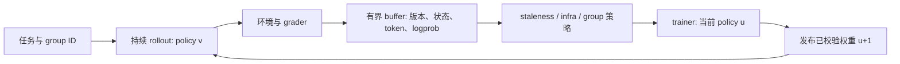

# 异步采样与训练推理一致性

> 资料快照：本组后训练项目资料整理截至 2026-10-11；文中的运行状态、访问结果和未核验项均以该次归档为准。

## 1. 为什么异步，付出的是什么代价

同步批次要等最慢的环境交互结束；工具调用与评分长尾会让 trainer 空闲。异步将完成的 group 放进 buffer，trainer 消费可用数据，同时推理继续生成。Miles 的公开工程介绍包含 sample 粒度补位与有界缓冲区。[Miles 异步说明](https://www.lmsys.org/blog/2026-08-18-miles-v0-1/)

代价是数据旧于当前权重，以及更复杂的重复/丢失/版本管理。整理建议是同时看吞吐、版本落后分布、丢弃率、任务构成与固定 benchmark。提高 GPU 利用率不代表得到同等有效学习量。

## 2. 需要保留的关联键

以下为建议的 trace 关联字段：run/attempt、optimizer step、trajectory/group/task ID、harness/grader revision、采样权重版本、训练权重版本、token/turn 边界、终止原因、评分状态、checkpoint ID。

MiMo Code 的 Uni-Agent 连接负责 gateway 与轨迹 capture，桥接代码把环境执行结果接入训练；这体现了“捕获真实交互”与“训练消费数据”的边界。[Code bridge](https://github.com/XiaomiMiMo/verl/blob/a2ad9f6160b03ff2d47e59832bfb6b289f37c917/recipes/code/mimoagent_runner.py)

## 3. Staleness 如何管理

MiMo Code 9B 开源脚本默认 `max_off_policy_threshold=2`、策略 `drop`。这是开源脚本的默认配置，不是对 Pro/Flash 全部生产运行的推断。[run_train.sh](https://github.com/XiaomiMiMo/verl/blob/a2ad9f6160b03ff2d47e59832bfb6b289f37c917/recipes/code/run_train.sh)

prime-rl 当前文档采用另一套配置与定义：版本落后包含 queue time，按产生该 rollout 的最旧版本计，过界数据丢弃。不同框架的阈值不能只看数字大小比较。[prime-rl 算法定义](https://github.com/PrimeIntellect-ai/prime-rl/blob/main/docs/algorithms.md)

建议记录均值、p95、最大值及每个任务族的分布。长任务若总被丢弃，异步训练会形成偏向短任务的隐藏课程。指标均值小也不能证明所有 partial segment 都接近当前策略。

## 4. Token-In-Token-Out 为什么重要

如果把模型输出解码成文本，再重新套聊天模板和 tokenizer，下一次训练的 token 序列可能与推理实际看到的不同。工具消息、thinking、分支与上下文压缩尤其容易触发。Miles TITO 材料强调保存原始 token 级交互与对应概率，再用于训练。[TITO 工程文章](https://www.lmsys.org/blog/2026-05-13-no-token-left-behind/)

整理建议是用真实多轮轨迹比较：输入 token 是否相同、动作 token 是否相同、loss mask 是否落在相同位置、各轮上下文是否对应，分支或压缩前后的样本是否仍能还原。字符串相同不是 token 一致性的充分验收。

## 5. 一致性检查的顺序

| 顺序 | 检查对象 | 不一致时先查 |
|---|---|---|
| 1 | checkpoint 与参数映射 | 模型转换、PP 层索引、未转换 buffer |
| 2 | tokenizer / renderer / token IDs | 模板、thinking、特殊 token、工具格式 |
| 3 | 采样与 trainer 的 logprob | 实际候选集、温度/top-p、概率重归一化 |
| 4 | 算子与精度 | 量化/QDQ、attention backend、batch 行为 |
| 5 | MoE routing | router 状态、实际 expert 选择、replay 数据 |
| 6 | 多轮与 partial 版本 | 权重更新时点、各段 logprob 归属、staleness |

这是诊断建议，不能把任何 KL 异常都归于 MoE。slime 调试文档建议先检查训练到推理的参数转换，分开保存 rollout 与训练输入，并对照初始化 logprob。[slime debug](https://github.com/THUDM/slime/blob/main/docs/en/developer_guide/debug.md)

## 6. 冻结 router 与 replay 解决不同问题

固定 router 参数可以减少训练引起的路由变化；router replay 则复用生成时的专家选择。两者不是互相替代的同一开关。小米报告介绍了路由与低精度的一致性方案，详细定位见 [报告索引](/papers/evidence/sources)；prime-rl 当前 RL 配置也有冻结 router 选项。[当前训练配置说明](https://github.com/PrimeIntellect-ai/prime-rl/blob/main/docs/training.md)

Replay 本身有工程成本。slime 的实际 Issue 报告路由 metadata 在广播过程中使主机内存急增，提出的 PR 截至检索仍为 Open，见 [故障手册](/papers/engineering/failure-handbook)。保留更多信息不一定更可靠，要按接收 rank 所需数据传输。

## 7. 看板上的两种 KL 不能混同

Pro 的 `actor/ppo_kl` 在公开逐步序列中为 0，但 `train_infer_diff/new_infer/kl` 非零。不同指标的计算对象和记录路径不同，不能由前者得出“训练推理完全一致”。详见 [训练指标分析](/papers/projects/mimo-v2-6/loss-and-metrics)。
