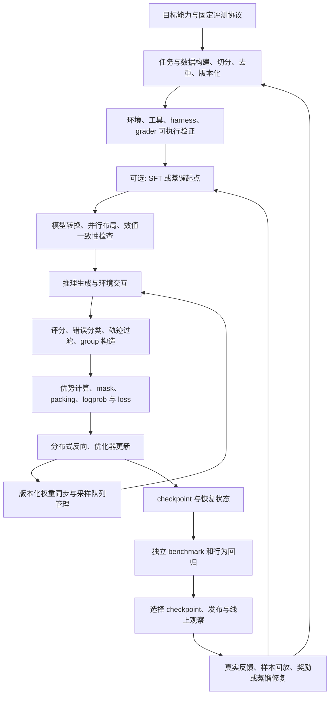

# 从数据到上线：后训练的工程闭环

> 资料快照：本组后训练项目资料整理截至 2026-10-11；文中的运行状态、访问结果和未核验项均以该次归档为准。

这张图是跨项目整理的流程模型。它不表示小米或其他团队逐步执行了完全相同的方案；具体事实见项目案例。SFT、偏好训练、RL、蒸馏可以组合，也可以省略某些阶段，例如 DeepSWE-Preview 公开的是从既有 Qwen3-32B 起点进行 RL。[DeepSWE 作者说明](https://www.together.ai/blog/deepswe)

## 1. 整体数据流

每一条箭头都有接口契约。数据字段、模型版本、token IDs、评分状态或 mask 中任一环错了，训练可能仍正常运行，却优化了错误对象。

## 2. 每个阶段应留下什么

以下是整理建议，可作为工程交接表。不要把“进程已启动”当成阶段完成。

| 阶段 | 输入 | 输出与记录 | 验收问题 | 对应材料 |
|---|---|---|---|---|
| 目标与评测 | 业务场景、能力缺口 | 固定任务、harness、采样与统计协议 | 改变的是能力还是测试方式？ | [评测闭环](/papers/engineering/evaluation-and-feedback) |
| 数据构建 | 代码、问题、测试、示范或偏好 | task ID、来源 revision、train/val/test 边界 | 原实现能通过测试，题目是否泄漏答案？ | [数据与环境](/papers/engineering/data-and-environments) |
| 环境与 grader | 镜像、依赖、工具接口、rubric | 冷启动/复用测试、grader 版本、错误分类 | 环境故障会被误记为模型失败吗？ | 同上 |
| SFT 起点 | 高质量示范轨迹 | tokenizer/template、loss mask、模型权重 | assistant/tool/observation 的训练边界是否正确？ | [奖励与算法](/papers/engineering/rewards-and-algorithms) |
| 启动配置 | 硬件、训练/推理模型格式、并行度 | resolved config、提交 SHA、资源映射 | 所有节点看见同一环境和共享路径吗？ | [运行检查](/papers/engineering/operations-and-recovery) |
| rollout | task、harness、policy version | trajectory ID、token IDs、行为 logprob、工具返回 | 提示/响应/分支截断是否一致？ | [异步与一致性](/papers/engineering/async-and-consistency) |
| 评分与 group | 原始产物与执行日志 | raw reward、penalty、infra status、group ID | 成功、失败、不可评分是否分开？ | [奖励与算法](/papers/engineering/rewards-and-algorithms) |
| 算法与训练 | 轨迹、优势、mask、行为概率 | loss、梯度、clip、token 分布、optimizer step | 是否在实际采样动作上计算更新？ | [训练指标](/papers/projects/mimo-v2-6/loss-and-metrics) |
| 权重同步 | 当前训练状态、目标推理布局 | 权重版本、转换校验、传输耗时 | 版本已确认加载，还是只有文件写入？ | [分布式性能](/papers/engineering/distributed-performance) |
| 容错恢复 | checkpoint、队列、数据源游标 | 恢复边界和重放记录 | 重复训练与丢样本是否可识别？ | [恢复](/papers/engineering/operations-and-recovery) |
| checkpoint 选择 | 固定 benchmark、真实行为回归 | 每步得分、协议、时延与成本 | 最后一步是否优于较早 checkpoint？ | [benchmark](/papers/engineering/evaluation-and-feedback) |
| 上线与修复 | 用户请求、失败样本 | API 权重时间、修复实验、回归结果 | 修复重复调用后正常多工具行为是否退化？ | [小米案例](/papers/projects/mimo-v2-6/) |

## 3. 三个关键分离

**任务数据与执行环境分离。** 一个 prompt 不是完整 agent 训练样本。代码任务还需要仓库 revision、镜像、工具、测试、评分和清理策略。MiMo 的开源连接由 mimoagent 承担环境/harness，Code 另经 Uni-Agent 捕获轨迹。[MiMo 代码入口](https://github.com/XiaomiMiMo/verl/tree/mimo-oss)

**采样与优化分离。** rollout 受长尾任务和外部工具影响；trainer 受 packing、并行和数值计算影响。异步队列提升重叠度，也引入旧策略数据，因此要记录实际行为策略版本和概率。[prime-rl 架构](https://github.com/PrimeIntellect-ai/prime-rl/blob/main/docs/overview.md)

**能力证据与优化诊断分离。** benchmark 判断是否泛化；reward 判断采样任务表现；loss、entropy、KL、gradient norm 判断更新过程。三者有关联，不能互相替代。小米的公开 archive 同时保存这些指标，见 [指标指南](/papers/projects/mimo-v2-6/dashboard-guide)。

## 4. 阅读术语

| 词 | 在本资料中的含义 |
|---|---|
| task / prompt | 一道任务及其输入；可能附带镜像、工作目录和评分元数据 |
| trajectory / rollout | 一次完整或截断的模型与环境交互尝试 |
| group | 同题多次尝试形成的相对比较单位；不等于随意混合的 microbatch |
| harness | 管理提示、工具、上下文、停止条件等交互规则的代理程序 |
| grader / verifier | 判断任务成果的服务或执行程序，可能用测试、规则或模型 rubric |
| behavior policy | 产生该 token/轨迹时实际使用的策略，异步训练中可能早于当前权重 |
| staleness | 采样到训练间的策略版本差；具体计法随框架不同 |
| microbatch | 单次计算的小批次，主要影响显存和吞吐 |
| global batch | 一次 optimizer 更新使用的总训练量，影响算法语义 |
| TP/PP/CP/EP/DP | 张量/流水线/上下文/专家/数据并行；不能把所有数直接相乘推卡数 |
| OPD / MOPD | 在模型自身生成分布上进行教师指导的蒸馏路线；具体损失依实现 |

本文保留必要英文名，是为了能直接对应源码与看板；没有源码定义的内部指标不强行解释。
