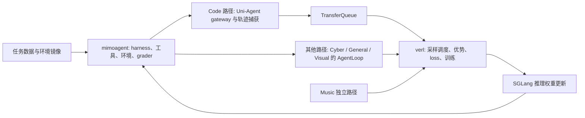

# 小米 MiMo-V2.6：从公开训练到上线修复

> 资料快照：本组后训练项目资料整理截至 2026-10-11；文中的运行状态、访问结果和未核验项均以该次归档为准。

本项目与 [目录中的各项目](/papers/projects/coverage)同等、独立研究。档案连续呈现运行、数据与复现、指标、事故和发布反馈；算法/分布式细节还需区分生产报告与 9B 代码。

| 全链路检查项 | 本档案入口与证据缺口 |
|---|---|
| 目标、模型起点与阶段 | §1、§5；9B 是 SFT 起点，Pro/Flash 原始训练配置不全 |
| 数据、环境、verifier 与算法 | §5；[9B 配置核对表](/papers/projects/mimo-v2-6/9b-config)；生产数据映射有缺口 |
| rollout、批次、并行与调度 | §2、§5；[异步与一致性](/papers/engineering/async-and-consistency)、[分布式](/papers/engineering/distributed-performance)；生产拓扑未公开 |
| loss、监控、性能与 benchmark | §2、§4；[完整损失分析](/papers/projects/mimo-v2-6/loss-and-metrics)及原始 CSV |
| 故障、回滚与 checkpoint 恢复 | §3；公告与有限事件窗口可见，全部恢复状态未知 |
| 发布、真实反馈与回归 | §6–§7；官方诊断、用户 Issue 与仍需取得的失败样本 |

## 1. 研究对象与证据链

这是 2026 年 9 月公开展示的 MiMo-V2.6 Pro/Flash RL 运行。[官方发布](https://mimo.mi.com/docs/en-US/news/latest/v2-6)明确回顾了六天 Live RL；[训练看板](https://mimo.xiaomi.com/rl/)公开了逐步指标、评分结果、运行状态和团队公告。罗福莉 [X 原帖](https://x.com/_LuoFuli/status/2100296686719610932)直接读取失败，因此不将转载的全文当作已核验原话。

最有价值的四类材料是：运行中的指标与公告、发布后的重复工具调用诊断、开源复现代码与任务数据、用户 Issue。它们能串起实际闭环，但开放程度不同。

| 对象 | 能观察什么 | 不能据此声称什么 |
|---|---|---|
| Pro/Flash 公开运行 | 指标、部分事件、成本计数、离线评测 | 全部 worker 日志、所有重启原因、完整生产配置 |
| 技术报告 | 方法、系统设计、实验表格 | 每一次事故的详细排查过程 |
| Qwen 9B 复现工程 | 可读配置、harness、环境与奖励连接 | 原始 Pro/Flash 集群的同等规模复现 |
| 发布后的用户反馈 | 实际工具循环等问题 | 所有流量的发生率或普遍根因 |

## 2. 运行规模：从归档读取

以下时间均为 **北京时间 UTC+8**。运行起止取自状态 JSON，不等于直播宣传发布时间，也不等于连续 GPU 忙碌时间。

| 字段 | Flash | Pro |
|---|---:|---:|
| 状态记录的开始 | 2026-09-15 23:16:29 | 2026-09-15 18:32:19 |
| 状态记录的结束 | 2026-09-19 10:22:09 | 2026-09-21 02:01:40 |
| 最终保留训练步 | 30 | 30 |
| 每步 prompts | 1,568 | 1,568 |
| 每步 trained trajectories | 25,088 | 25,088 |
| 累计 trained trajectories | 752,640 | 752,640 |
| 状态中的累计 trained tokens | 81.3977B | 75.00439B |
| 最后一步 trained tokens | 3.69598B | 3.43137B |
| 重启计数 | 5 | 14 |
| 看板累计成本，USD | 854,044.70 | 2,620,670.84 |
| 成本计数速率，USD/s | 2.855 | 5.71 |

来源：[Flash 状态](https://mimo.xiaomi.com/rl/data.04135c89/status-flash.json)、[Pro 状态](https://mimo.xiaomi.com/rl/data.04135c89/status-pro.json)。25,088 = 1,568 × 16；这是轨迹数，不是不同任务数。30 步累计量也不能当成全部尝试量，因为采样失败、被过滤的轨迹和回滚尝试不一定计入这一口径。

成本字段是归档的计数模型，近似对应运行时长乘固定费率；并非公开审计过的 GPU 账单。没有足够证据从费率反推卡型、卡数或采购成本。

## 3. 事故与调整时间线

时间取公告发布时间；实际故障可能早于公告。公告中的 `run` 字段均为空，下表按正文辨认模型。

| 北京时间 | 公告内容的归纳 | 直接说明的行动 | 尚未公开的细节 |
|---|---|---|---|
| 09-17 01:58 | 发布 Flash step 12 / Pro step 8 的 DeepSWE 离线结果 | 评测异步回填 | 每次评测排队与运行耗时 |
| 09-17 04:08 | Pro 某节点发生 VRAM 问题 | 重启 | 是否硬件故障、泄漏或峰值越界 |
| 09-17 10:27 | Flash 某数据集的一类 infra error 在过去约三小时未正确识别 | 从 step 15 重新开始 | 错误类型、污染样本数、识别修补代码 |
| 09-17 20:20 | Pro 训练集群与 grader 部署之间网络连接异常；rollout 出现不良模式 | 重启；后续 Pro 移除 cyber 数据 | 不良模式定义、网络层根因 |
| 09-18 11:49 | Pro 专家负载不均衡引起 GPU OOM，在 step 17 处重启 | 调整训练并行策略 | 调整后的 TP/EP/PP/CP 数值 |
| 09-19 18:14 | Pro 筛掉了对当前模型相对简单的任务 | 调整任务分布 | 筛选阈值、保留清单和新采样权重 |

来源：[团队公告归档](https://mimo.xiaomi.com/rl/data.04135c89/notices.json)。这些说明直接把“reward 数据质量”和“系统恢复”联系在一起。Flash 的问题不是普通的模型答错：错误分类失效会使训练数据不可信，因此团队进行了回滚。

### 可验证的一次回滚

Flash 的末尾事件窗口保留了 step 16、17 的原始与重做条目，`redo=true` 可直接看到。最终逐步曲线只保留一组值，会隐藏被替换的尝试。

| 步数 | 原始 avg@n | 重做 avg@n |
|---|---:|---:|
| 16 | 0.602504 | 0.594958 |
| 17 | 0.585664 | 0.601257 |

来源：[Flash 事件](https://mimo.xiaomi.com/rl/data.04135c89/status-flash.json)。不能用这两个数字推断回滚产生了净能力提升：任务构成、采样随机性和错误过滤也可能不同。能确认的是训练分支被替换。

状态显示合计 19 次重启，但六条公告只解释其中部分。末尾窗口也没有覆盖全部事件。这里没有为未说明的重启补写根因。

## 4. 曲线怎么读

| 指标 | Flash step 1 → 30 | Pro step 1 → 30 | 能说明什么 |
|---|---:|---:|---|
| `dynsam/avg@n` | 0.513693 → 0.643526 | 0.564662 → 0.633138 | 当前采样任务上每题 n 次尝试的平均成功比例 |
| DeepSWE v1.1 | 48.67 → 65.68 | 58.41 → 72.57 | 固定标注协议下的离线能力证据 |

训练指标来源：[Flash 序列](https://mimo.xiaomi.com/rl/data.04135c89/series-flash.json)、[Pro 序列](https://mimo.xiaomi.com/rl/data.04135c89/series-pro.json)。指标定义来源：[看板元数据](https://mimo.xiaomi.com/rl/data.04135c89/runs.json)。`avg@n` 不是“n 次至少成功一次”的 `pass@n`，也不能等同于 rollout 的平均数值 reward。

DeepSWE 采用 **mini-swe-agent，avg@3**。Flash 从第一步到最后一步增加 17.01 个百分点；Pro 增加 14.16 个百分点。这是归档内 step 1 对 step 30 的比较，step 1 已是训练步，不是未训练基线。Flash 最高值为 step 28 的 67.86，最后一步不是最高点。Pro 26、30 步均为 72.57。[评测归档](https://mimo.xiaomi.com/rl/data.04135c89/benchmarks.json)

同一归档还包含 In-house Coding Bench 和 AutomationBench v1.0.6，均标为 avg@3。Pro 这两项的最后公开点为 step 29，不应补成 step 30。全部结果见 [离线评测 CSV](/papers/projects/mimo-v2-6/evidence/离线评测.csv)。

### 不能做的因果解释

1. 移除 cyber 和筛简单题会改变训练指标的统计总体，前后 reward 不能作为纯粹的能力差。
2. 最后一次 `live` 采样器步数可以超过 30；采样器准备下一批不意味着 optimizer 做了第 31 次更新。
3. 沙箱计数远高于轨迹数，不能直接解释为不同训练题数，也不是 GPU 数。
4. 异步流水线的 rollout 与 trainer 用时可能重叠，不能简单相加再推 GPU 利用率。
5. 评测缺点和波动不构成失败原因证据；需要对应 checkpoint、样本及评分日志。

## 5. 数据与工程开放到了哪一层

[MiMo-V2.6-RL-oss 数据集](https://huggingface.co/datasets/XiaomiMiMo/MiMo-V2.6-RL-oss)公开五类任务，页面合计 7,780 条、约 12.1GB。Code 样本中可见 `data_source`、`ability`、`agent_name`、`prompt`、`reward_model`、`extra_info`；额外元数据含环境镜像、工作目录和 instance 信息。它是开源复现的任务集合，不能当成生产运行全部训练样本的逐条公开。

代码入口：[XiaomiMiMo/verl](https://github.com/XiaomiMiMo/verl/tree/mimo-oss)。此次读取的分支头为 `a2ad9f6160b03ff2d47e59832bfb6b289f37c917`。其组合关系如下：

该图描述开源复现的连接关系；不是完整生产架构拓扑。[Code 桥接代码](https://github.com/XiaomiMiMo/verl/blob/a2ad9f6160b03ff2d47e59832bfb6b289f37c917/recipes/code/mimoagent_runner.py)、[General AgentLoop](https://github.com/XiaomiMiMo/verl/blob/a2ad9f6160b03ff2d47e59832bfb6b289f37c917/recipes/general/agent_loop.py)

### 9B 的定位必须先确认

[MiMo-V2.6-Distill-Qwen-9B](https://huggingface.co/XiaomiMiMo/MiMo-V2.6-Distill-Qwen-9B)是基于 Qwen3.5-9B、使用 MiMo 生成数据的 SFT 起点，用于继续做 RL。它本身不能当作完成开源 RL 的结果，更不能当作直播中的 Pro/Flash。技术报告中的单域 RL 表格也不是一个同时获得全部单域成绩的统一 checkpoint。

## 6. 上线后的反馈闭环

发布后出现重复工具调用反馈。官方在 09-27 给出诊断：原训练把单轮工具调用的惩罚触发上限设为 32，这可能放大未触发阈值的重复行为。针对性缩小上限的试验有效，但把这一修复放进完整任务混合需要很高成本，随后采用专门教师及 MOPD 修复。[官方诊断](https://mimo.xiaomi.com/blog/mimo-v2-6-tool-call-repetition)

官方的重复率按单轮内规范化 JSON 工具调用去重计算，未覆盖跨轮和近似重复；所报告样本来自筛选/回放实验，不能当作全部线上流量发生率。MOPD 修复回滚五步后加入教师指导，报告约 9 万美元开销；API 于 09-25 北京时间 06:00 更新，模型名称保持一致，因此只记 API 名无法定位行为版本。[同一诊断](https://mimo.xiaomi.com/blog/mimo-v2-6-tool-call-repetition)

[Issue #98](https://github.com/XiaomiMiMo/MiMo/issues/98)是重复调用的用户反馈入口；[Issue #102](https://github.com/XiaomiMiMo/MiMo/issues/102)报告修复后对有效多工具调用可能过度抑制。这些都是应纳入回归测试的行为线索，不是已独立验证的普遍结论。

## 7. 本案例带来的可执行问题

以下是整理建议，适合转成自己训练的验收项：

- 错误分类漏检时，能否从样本定位到被影响的 optimizer 更新，并明确回滚边界？
- task、grader 和 harness 是否独立版本化，修分类规则后是否回放旧样本验证？
- MoE 负载指标是否与 OOM 的 rank、层、阶段对应，改变并行策略后是否重新检查数值一致性？
- 调整任务难度后，是否保留固定评测集和任务分布快照？
- 限制重复调用时，是否同时测试正常连续工具使用，防止过度抑制？

本项目需要继续追踪的原始材料列在 [未公开项](/papers/evidence/gaps)。目前最关键的缺口是生产运行 resolved config、全部重启日志、错误样本/评分记录和各次并行调整参数。
