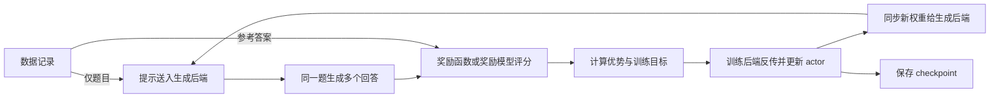

# 后训练 RL 框架怎么选、怎么用：从零认识 TRL、verl、OpenRLHF、slime 与 AReaL

懂 Python、知道大模型可以微调，就可以从这里开始。本文先解释一次强化学习训练怎样发生，再沿着数据、奖励、配置、启动、保存与验证介绍五个框架。读完后，应当能判断自己的任务值得从哪个框架开始，以及第一份训练配置要改哪些地方。

> 原稿日期：2026-10-16；本次修订与官方资料核查：2026-10-19（Asia/Shanghai）。本文依据公开文档、固定版本源码和已有核对记录编写，没有安装训练环境、运行 GPU 训练或复现成绩。下面的命令均是依据注明版本整理、供读者准备环境后使用的路线；不表示已在本环境执行成功。

这里的“主流”指有公开实现、文档和训练案例的代表性路线，不是市场份额排名。五个框架能力有重叠，本文也不穷尽所有项目。SFT、DPO 用来交代后训练的位置，正文重点是**在线 RL**。vLLM、SGLang 是生成引擎，FSDP、DeepSpeed、Megatron 是训练与并行基础设施；Open R1 是项目，DAPO、ProRL 是算法或训练配方，不能把它们与框架混在一张排行榜里。

## 1. 一次后训练到底在做什么

### 从一道数学题看完整循环

预训练让模型学会根据前文预测后文；后训练继续改变模型参数，让它在指定任务上按需要回答。常见路径有三种：SFT 用“问题—示范答案”训练；DPO 使用同一问题下的偏好答案对；在线 RL 则在训练过程中让当前模型自己作答，再用反馈更新模型。PPO、GRPO 是构造更新目标的方法，框架负责把数据读取、生成、评分、反向传播、分布式资源和存盘接起来。下面的真实 GSM8K 例子来自 [verl v0.9.1 Quickstart](https://github.com/verl-project/verl/blob/v0.9.1/docs/start/quickstart.rst)：

- **问题**：Katy 做咖啡，糖的茶匙数与水的杯数之比为 7:13，两者合计 120，糖用了多少茶匙？（此处为原题中文转述。）
- **参考答案**：糖占 7/20，因此是 7/20×120＝42；原始解答以 `#### 42` 结尾。
- **模型输出**：训练时现生成的解答，可能正确，也可能算错。下面用“解答最后写 `#### 42`”和“写 `#### 40`”作示意，不是实际采样记录。
- **规则反馈**：verl 此示例的评分器抽取最后的 `#### 数字`，与参考值字符串比较；默认正确得 1，错误或无法抽取得 0。参考答案只交给评分器，不能放进模型的题目里。



图示是便于理解的同步循环；异步系统会让其中一些阶段重叠。训练最终交付的是新的 **checkpoint（模型检查点）**，推理时才用它为新问题生成回答。训练期间看到一条正确回答，不能证明保存的模型整体提高了，仍要在未参加训练的题目上比较。

GRPO 用同一提示下多个回答的奖励作相对比较，通常不另训 critic；如果一组回答全对或全错，组内比较提供的信号可能很弱。PPO 的常见 GAE 路径会训练 critic 来估计价值。是否使用参考策略、KL 惩罚、怎样归一化奖励和聚合 token 损失，仍需看具体配置；同叫 `GRPOTrainer` 的训练未必用了相同损失。[TRL 方法与配置](https://github.com/huggingface/trl/blob/v1.16.0/docs/source/grpo_trainer.md)、[verl 角色判定](https://github.com/verl-project/verl/blob/v0.9.1/verl/trainer/ppo/utils.py)支持这些区分。

### 先认识配置中的角色和资源

| 名称 | 在循环中负责什么 | 是否总需要 |
| --- | --- | --- |
| actor / policy | 正在学习的模型，训练后保存它 | 是 |
| rollout | 用模型采样回答；多轮任务中还包含交互轨迹 | 在线 RL 需要 |
| reward | 衡量回答或轨迹质量，可以是 Python 规则、测试执行器或奖励模型 | 需要反馈，但不一定需要奖励模型 |
| reference | 一份参考策略，常用于限制偏离程度的 KL 项 | 由训练目标决定 |
| critic / value | 估计状态或 token 位置的价值，辅助计算优势 | 常见 PPO 路径需要，GRPO 路径通常不需要 |

“优势”衡量一次回答相对基线有多好；GRPO 常用同题回答的组内奖励作基线。loss 是要通过梯度更新优化的目标；logprob 是模型给已生成 token 的概率取对数，训练会用它计算新旧策略的概率比。KL 项用于衡量并惩罚相对参考策略的偏离。奖励负责评判任务完成情况，这些量则把反馈变成参数更新。[TRL 方法说明](https://github.com/huggingface/trl/blob/v1.16.0/docs/source/grpo_trainer.md)

训练侧需要保存梯度和优化器状态，生成侧需要尽快把回答采出来。因此框架常分别接训练和推理引擎。两边即使是同一个模型，也可能使用不同的卡数、权重切分和数值计算实现，更新后要把训练侧参数交给生成侧。[verl 架构](#source-s1)、[OpenRLHF 架构与同步](#source-s9)

| 配置术语 | 理解到这里就够用 |
| --- | --- |
| DP / TP / PP | 数据并行把不同样本分给多份模型；张量并行把层内计算拆到多卡；流水线并行把不同层分到多卡。训练 TP 和生成 TP 可以不同 |
| ZeRO / FSDP | 把优化器状态、梯度或参数分片，减轻每卡训练内存负担；有通信和临时聚合成本 |
| LoRA | 主要训练低秩适配参数；可减少可训练状态，但生成的 KV cache 等开销仍在 |
| KV cache | 生成时缓存已处理 token 的注意力键和值，长度和并发会影响它的显存占用 |
| offload / sleep | 阶段切换时释放或搬走一部分状态；显存下降可能伴随主机内存和搬运开销 |
| Ray / Hydra | Ray 把 Python 任务和 worker 分配到单机或集群资源；Hydra 将默认配置、文件和命令行覆盖合成生效配置 |

**设备怎么摆，与循环是否重叠，是两个维度。**

| 维度 | 一端 | 另一端 |
| --- | --- | --- |
| 部署位置 | 共置：训练和生成共享 GPU | 分离：各自有 GPU 或节点 |
| 执行时序 | 同步：收齐本轮生成，再训练、交接权重 | 异步：用队列等机制让生成和训练重叠 |

因此 TRL 的 `colocate/server` 不能自动翻译成“同步/异步”。异步还要处理**策略滞后**：样本可能由旧版本模型生成；partial rollout 甚至可让一条轨迹跨权重版本。另一个独立问题是训练引擎与生成引擎计算 logprob 的数值差异。搬运权重、限制版本落后、重算或校正概率各有用途，不能互相替代。[TRL 配置](#source-s4)、[AReaL 异步文档](#source-s11)

### batch 一定要带单位

以 **32 个提示×每提示 8 个回答＝256 条回答** 为例。提示 batch 是 32，回答 batch 是 256；这些回答长短不同，token 总量还会变。micro-batch 是一次前后向处理的一小批；梯度累积把多次前后向合成一次 `optimizer.step()`。一个 rollout batch 能拆成多少次更新，还取决于 mini-batch、训练轮数和是否重复使用样本。

这个数字关系确实出现在后文 slime 的官方脚本中，但不能照抄成别的框架的 `train_batch_size`。尤其动态过滤会先生成更多提示、再挑出有训练信号的组；日志中的 rollout step、optimizer step、权重版本和监控刷新也未必一一对应。

## 2. 先把五个框架放在同一张表里

以下是按接口和部署要求作出的选型判断，依据在各节的固定版本文件中展开，没有横向吞吐实测。

| 框架 | 值得考虑它的具体原因 | 本文训练路线 | 主要前提与代价 |
| --- | --- | --- | --- |
| TRL | Python Trainer API，沿用 HF 模型、数据集和训练参数；容易看清奖励函数怎样接入 | Qwen2.5-0.5B-Instruct＋GSM8K 的教学改写，再看 Open R1 | 熟悉 Transformers 更容易上手；分布式和生成服务仍需配置，便利不等于任意模型单卡可跑 |
| verl | 配置化连接采样、奖励、更新，训练与生成可采用不同后端和并行布局 | 官方 PPO 入门；另给真实 Qwen3-4B GRPO 脚本 | 需要研究配方、多后端或资源布局时有价值；配置项和依赖组合多 |
| OpenRLHF | Ray 编排组件，DeepSpeed 更新、vLLM 生成；可分别配置组件资源 | 固定提交的 ProRL v2 数学脚本 | 适合已有 Ray/DeepSpeed 经验的团队；GPU 共置、主机内存、进程与依赖要一起管理 |
| slime | 接通 Megatron 与 SGLang，模型并行、rollout 和奖励可定制 | Qwen3-4B＋DAPO 数学数据 | 已有 Megatron/SGLang 经验更合适；先处理模型参数、权重转换和补丁栈 |
| AReaL | 把异步生成、训练、策略版本约束与 agent workflow 接口放在一起 | GSM8K YAML＋MathAgent | 值得用于长轨迹、交互等待、耗时差异大的任务；收益依赖瓶颈，调度和偏策略调试更复杂 |

不能据此认为 TRL 只能训练小模型、slime 只能训练大模型、AReaL 只能异步，或其他框架不能做 agent。表格描述的是从哪里进入最容易理解。若目标是部署模型、全量预训练或已经固定在另一套训练平台中，这五者也不是唯一选择。

## 3. TRL：先把 Python 训练闭环看清楚

### 为什么从它开始

TRL 将后训练算法封装成 Trainer。你主要提供模型、数据集、训练参数和奖励函数，训练器管理采样、奖励计算和参数更新。对已有 Hugging Face（简称 HF）流程、想先验证奖励设计的人，这样可以较直接地定位自己要改的代码。代价是显存规划、数据格式和分布式设置仍由使用者负责；开启 vLLM 后还多出生成引擎的兼容与资源配置。

本节采用 **TRL v1.16.0，提交 `1b5c75ed94b7387f42532adb090c935166d4878d`**。已读此版 [GRPO 教程](https://github.com/huggingface/trl/blob/v1.16.0/docs/source/grpo_trainer.md)、[GRPOConfig](https://github.com/huggingface/trl/blob/v1.16.0/trl/trainer/grpo_config.py)、[奖励实现](https://github.com/huggingface/trl/blob/v1.16.0/trl/rewards/accuracy_rewards.py)与 trainer 传参段。官方入门用 DeepMath-103K；下面为了串起前文 GSM8K 的“题目—答案—奖励”，**将数据转换换成 GSM8K，显式添加教学参数与保存调用**。这不是官方原样脚本，也不是调优结果。

### 数据怎样进入奖励函数

TRL 读取 `prompt`，会把数据中其他列传给奖励函数。内置 `accuracy_reward(completions, solution, **kwargs)` 读取对话格式的生成消息和 `solution`，使用数学解析与等价验证；参考答案无法解析时返回 `None`。它与 verl 默认的 `####` 字符串匹配评分器不同，奖励数值不宜直接横比。

前述题目在这里转换成如下结构；为节省篇幅，题目中文转述，字段结构与下面转换函数一致：

```json
{
  "prompt": [{"role": "user", "content": "糖与水的数量比为7:13，合计120，糖有多少？请把最终答案写在\\boxed{}中。"}],
  "solution": "\\boxed{42}"
}
```

这是**从真实题目整理的字段示意**，不是数据集中的原始 JSON。模型只看到 `prompt`；`solution` 留给奖励函数。`\boxed{42}` 与参考数学答案等价时给正确性奖励，不要求逐字复制推理过程。[数据附加列的传递实现](https://github.com/huggingface/trl/blob/v1.16.0/trl/trainer/grpo_trainer.py)、[accuracy_reward](https://github.com/huggingface/trl/blob/v1.16.0/trl/rewards/accuracy_rewards.py)

### 一份可继续修改的教学脚本

此版本 `pyproject.toml` 要求 Python≥3.11、Accelerate≥1.10.1、Transformers≥4.56.2；数学奖励另需 `math_verify` extra。先在独立训练环境中安装 `trl[math_verify]==1.16.0`，按实际 CUDA/PyTorch 环境配置 Accelerate。依赖下限不等于完整锁文件；正式实验还要记录实际解析出的依赖、模型和数据 revision。[版本依赖](https://github.com/huggingface/trl/blob/v1.16.0/pyproject.toml)

下面保存为 `train_grpo.py`。字段转换参考已读的 GSM8K 预处理逻辑；`num_generations=4`、batch、长度和 20 步均为本文教学选择，目的是检查接口，不保证收敛或显存可容纳。

```python
from datasets import load_dataset
from trl import GRPOConfig, GRPOTrainer
from trl.rewards import accuracy_reward

raw = load_dataset("openai/gsm8k", "main", split="train")

def to_grpo(row):
    final_answer = row["answer"].rsplit("####", 1)[1].strip().replace(",", "")
    return {
        "prompt": [{"role": "user", "content": row["question"]
                    + r" Please put your final answer within \boxed{}."}],
        "solution": r"\boxed{" + final_answer + "}",
    }

dataset = raw.map(to_grpo, remove_columns=raw.column_names)
args = GRPOConfig(
    output_dir="outputs/trl-gsm8k",
    per_device_train_batch_size=4,
    gradient_accumulation_steps=1,
    num_generations=4,
    max_completion_length=512,
    temperature=1.0,
    learning_rate=1e-6,
    loss_type="grpo",
    beta=0.0,
    num_iterations=1,
    scale_rewards="group",
    use_vllm=False,
    remove_unused_columns=False,
    max_steps=20,
    save_steps=10,
    logging_steps=1,
    report_to="none",
)
trainer = GRPOTrainer(
    model="Qwen/Qwen2.5-0.5B-Instruct",
    args=args,
    reward_funcs=accuracy_reward,
    train_dataset=dataset,
)
trainer.train()
trainer.save_model("outputs/trl-gsm8k/final")
```

启动入口沿用同版教程：

```bash
accelerate launch train_grpo.py
```

`num_generations` 是每题回答数；TRL 的 generation batch 按展开后的回答计数，并必须能被它整除。这里显式选择 `loss_type="grpo"`，不会随当前默认值 `dapo` 漂移；`beta=0` 关闭 KL 惩罚，不意味着所有 GRPO 都不需要 reference。这份脚本只显式限制回答长度；接长提示数据前还要根据 tokenizer 和上下文窗口检查输入长度。降低参数量也不能替代显存估算。

训练中由 `output_dir` 和保存间隔控制检查点，末尾 `save_model` 输出用于加载的最终模型；继续训练还要保留训练状态检查点。下一步应在 GSM8K `test` 或自己的独立题集上，用相同提示、生成预算和评分器比较原模型与最终模型，记录正确率、抽取失败率和回答长度。脚本只覆盖训练接口，**没有附带一次已执行的独立评估**。

### 从本地生成扩展到 vLLM，再读 Open R1

不使用 vLLM 时，常规 GRPOTrainer 由模型自身生成；使用时可选 `colocate` 共享训练 GPU，或 `server` 放到独立服务。分离服务需要单独安排设备、地址和服务环境，也需要同步更新权重。这两种摆法不自动启用异步训练。当前发布页另有 AsyncGRPO 路线，因此本文只对这里选用的常规 `GRPOTrainer` 作说明，不把它当成 TRL 全部能力的边界。[v1.16.0 配置](https://github.com/huggingface/trl/blob/v1.16.0/trl/trainer/grpo_config.py)、[发布说明](https://github.com/huggingface/trl/releases/tag/v1.16.0)

**Open R1 是更完整的项目例子。** 固定提交 `5b6ff22b3fb7aa069c54866e517f39dfc3160e09` 的 [grpo.py](https://github.com/huggingface/open-r1/blob/5b6ff22b3fb7aa069c54866e517f39dfc3160e09/src/open_r1/grpo.py) 把题目列转成对话提示，接入奖励注册表、`GRPOTrainer`、恢复、保存和可选评估；[YAML](https://github.com/huggingface/open-r1/blob/5b6ff22b3fb7aa069c54866e517f39dfc3160e09/recipes/Qwen2.5-1.5B-Instruct/grpo/config_demo.yaml) 配 Qwen2.5-1.5B-Instruct、OpenR1-Math-220k、16 个回答、每设备 batch 16、梯度累积 4、提示/回答上限 512/1024。README 的命令以 8×H100 80GB 为机器假设，并说明共置和独立 vLLM server；这不是 TRL 最低配置。[S6](#source-s6)

这份历史 YAML **没有填 `loss_type`**。后来 TRL 快照与当前 v1.16.0 的默认值为 `dapo`，也不能据此反推 Open R1 当时的实际损失。复用项目时，要同时固定项目提交、TRL 依赖和生效配置；不要把上面新版本的安装方式接到历史项目上就称为复现。历史 YAML 还启用了 Hub 推送和 W&B，纯本地实验应主动关闭这些选项。

## 4. verl：从数据和配置进入多后端训练

### 优势与使用前提

verl 用控制器串联后训练的数据流，训练后端与生成后端可以采用不同并行布局，并在交接时重新切分权重。历史 README 列出 FSDP/FSDP2/Megatron 训练与 vLLM/SGLang/HF 生成，也有异步实验入口；这些清单不保证所有排列组合在每个版本都兼容。[S1](#source-s1)

它适合需要修改采样数量、优势估计、KL、loss、奖励和多卡布局的研究工作。相应代价是配置维度多：同一个 `main_ppo` 入口可以跑不同算法，既要读启动脚本，也要读其合并的默认配置。下面固定 **v0.9.1，提交 `1876b06d0a3e4e71e06230be10af14492ca8a75b`**，分别介绍该版的 PPO 入门与 GRPO 脚本，不把两者拼成一个例子。

### 数据与奖励：为什么先生成 Parquet

同版 [gsm8k.py](https://github.com/verl-project/verl/blob/v0.9.1/examples/data_preprocess/gsm8k.py) 读取 GSM8K，将题目添加“逐步思考并在 `####` 后输出答案”的指令，把参考解答末尾数字提取为 `ground_truth`，生成训练和测试 Parquet。关键字段如下（题目省略；这是对转换后结构的示意）：

```json
{
  "data_source": "openai/gsm8k",
  "prompt": [{"role": "user", "content": "题目 + 输出格式指令"}],
  "ability": "math",
  "reward_model": {"style": "rule", "ground_truth": "42"},
  "extra_info": {"split": "train", "index": 0, "answer": "原始解答", "question": "原始题目"}
}
```

`data_source` 用来选择评分器，`prompt` 是生成输入，`reward_model.ground_truth` 是奖励标签，`extra_info` 留存样本来源。这一示意的 `index=0` 只解释字段，不宣称咖啡题在原数据中的索引。[奖励分派](https://github.com/verl-project/verl/blob/v0.9.1/verl/utils/reward_score/__init__.py) 对 `openai/gsm8k` 调用 [gsm8k.compute_score](https://github.com/verl-project/verl/blob/v0.9.1/verl/utils/reward_score/gsm8k.py)，默认只在生成末尾最多 300 个字符里寻找最后一个 `#### 数字`。没有标记、格式不匹配，即使文字里出现正确数字也未必得分。

### PPO 入门与 GRPO 路线各怎么开始

同版 [Quickstart](https://github.com/verl-project/verl/blob/v0.9.1/docs/start/quickstart.rst) 是 **PPO**：Qwen2.5-0.5B-Instruct，actor 和 critic 分别设置模型路径，vLLM 生成；配置默认优势估计是 `gae`。它写的准备条件包括至少 24 GB HBM 的 GPU，并提供单 GPU 参数组，这只是这条教程的条件。教程还提示低显存时调整 micro-batch；它不构成本文对显存的测试。

下面选用实际读过的 [Qwen3-4B GRPO 脚本](https://github.com/verl-project/verl/blob/v0.9.1/examples/grpo_trainer/run_qwen3_4b_fsdp.sh) 展示另一条完整启动路线。该版 [安装说明](https://github.com/verl-project/verl/blob/v0.9.1/docs/start/install.rst) 的 uv 流程面向 Linux/Python 3.12，由提交中的 `uv.lock` 和 extras 选择环境；从检出 v0.9.1 的 verl 仓库根目录执行：

```bash
uv run --frozen --all-packages --extra vllm --extra fsdp \
  python3 examples/data_preprocess/gsm8k.py --local_save_dir "$HOME/data/gsm8k"

PROJECT_NAME=gsm8k_grpo EXPERIMENT_NAME=qwen3_4b \
  bash examples/grpo_trainer/run_qwen3_4b_fsdp.sh \
  'trainer.logger=[console]'
```

第二条命令沿用官方脚本的环境变量和尾部配置覆盖；本文改了实验名、将日志限为 console。脚本自己通过 `uv run` 启动 driver，并给 Ray worker 设置同样环境，不能只保证主进程装了依赖。模型与数据路径可改 `MODEL_PATH`、`TRAIN_FILE`、`TEST_FILE`；完整脚本中的默认值及含义是：

| 配置组 | 此 GRPO 脚本的设置 | 改它会影响什么 |
| --- | --- | --- |
| 模型与资源 | Qwen3-4B、1 节点、每节点默认 8 GPU | 模型大小与训练资源；GPU 型号未注明 |
| 训练后端 | FSDP；默认配置 `dp_actor.yaml` 中 `strategy: fsdp` | 参数分片与更新；不能只看入口名判断后端 |
| 数据与 batch | 512 个训练提示，每提示 5 个回答；PPO mini-batch 256、每 GPU micro-batch 2 | 生成量、更新批次和显存；动态 token batching 也已启用 |
| 长度与生成 | 提示/回答上限 1024/1024；vLLM TP2，显存利用参数 0.6 | 上下文、并发与生成资源 |
| 算法 | `adv_estimator=grpo`，actor KL loss 开启，系数 0.001；reward KL 关闭 | 不走默认 GAE critic 路径；KL 所在位置不同 |
| 保存与验证 | 每 20 步保存、每 5 步验证，15 epochs | 存盘频率、测试成本和训练时长上限 |

[入口](https://github.com/verl-project/verl/blob/v0.9.1/verl/trainer/main_ppo.py) 用 Hydra 加载 [ppo_trainer.yaml](https://github.com/verl-project/verl/blob/v0.9.1/verl/trainer/config/ppo_trainer.yaml)，再决定 trainer 路线；[need_critic](https://github.com/verl-project/verl/blob/v0.9.1/verl/trainer/ppo/utils.py) 按配置判定是否需要 critic。上面的脚本还开了动态 batch，所以不能把 micro-batch 数字当作实际每次固定 token 数。修改奖励可从 `compute_score` 及 reward 配置进入，修改生成环境可沿 agent loop 接口扩展；这里只审了单轮数学任务。

### 保存、导出与 DAPO 进阶

默认训练目录是 `checkpoints/<project_name>/<experiment_name>`。同版 [model_merger](https://github.com/verl-project/verl/blob/v0.9.1/verl/model_merger/__main__.py) 提供 FSDP/Megatron 分片合并；下面依据 Quickstart 改成本文实验名和**示例 step 20**。使用前必须确认该步确实生成了目录，不能只根据保存间隔假定文件存在：

```bash
uv run --frozen --all-packages --extra vllm --extra fsdp \
  python3 -m verl.model_merger merge --backend fsdp \
  --local_dir checkpoints/gsm8k_grpo/qwen3_4b/global_step_20/actor \
  --target_dir outputs/verl-qwen3-4b-hf
```

训练内验证用 `data.val_files` 与 `trainer.test_freq`；导出后还应另用相同生成预算评估原模型与导出模型，检查 tokenizer、chat template 和评分器是否一致。合并成功只证明产生了模型文件，不能替代质量验证。

<details>
<summary>DAPO 历史案例：生成 batch 与训练 batch 为什么不同</summary>

固定 `4f80e465c2ec79ab9c3c30ec74b9745de61d0490` 的脚本使用 Qwen2.5-32B：生成提示 `512×3=1536`，训练提示 512，每题 16 回答，提示 mini-batch 32。动态过滤丢弃组内指标相同的提示，再继续生成以凑齐训练 batch，最多尝试 10 批。优势估计为 `grpo`，clip 0.2/0.28，loss 聚合 `token-mean`，reward KL 与单独 KL loss 都关闭；rollout TP4、显存利用参数 0.7。[S2](#source-s2)

| 项目 | DAPO 报告 v2 第 4.1 节 | 该历史脚本 |
| --- | --- | --- |
| rollout 提示 | 512，每题 16 回答 | 生成 1536，训练 512，每题 16 回答 |
| 训练 mini-batch | 512，并写每次 rollout 做 16 次梯度更新 | 提示 mini-batch 32，传给 `ppo_mini_batch_size` |
| warm-up | 20 个 rollout step 的线性 warm-up | `lr_warmup_steps=10` |

计步单位未完全对齐，不能把差异改写成一个一致数字。复现表里的机器是 16 节点×8 H800，属于该案例，不是 verl 入门要求；此历史脚本也不直接套用 v0.9.1 安装环境。[S2](#source-s2) [S3](#source-s3)

</details>

## 5. OpenRLHF：把训练、生成和奖励作为组件部署

### 为什么考虑这条路线

这条实现由 Ray 调度组件，DeepSpeed 负责更新，vLLM 负责生成。组件可以分开部署，也可以共置；资源配置明确写到 actor、reference、生成引擎。已有 Ray/DeepSpeed 运维经验、需要管理多个训练与评分组件的团队，可以沿这套结构扩展。代价是要同时理解调度、主机内存、GPU 占用和引擎版本，Ray 本身不计算梯度。

早期权重同步文档讲过 actor—vLLM 的 NCCL，以及共置 hybrid engine 的 CUDA IPC。两者有具体部署与版本条件，不能把旧博文当成最新版的统一默认协议。[S9](#source-s9) 本次可见最新 release 是 v0.11.2；以下 ProRL 路线仍固定原稿的 **`dc2a7ad326f619fc5a47737ea47d1920ce2c0b53`**，不宣称它等于 v0.11.2。

### 用一份真实脚本看清输入和更新目标

已读的 [ProRL v2 脚本](https://github.com/OpenRLHF/OpenRLHF/blob/dc2a7ad326f619fc5a47737ea47d1920ce2c0b53/examples/scripts/train_prorlv2_math_hybrid_engine.sh) 使用 DeepSeek-R1-Distill-Qwen-1.5B、`OpenRLHF/dapo-math-17k`，数据列为 `prompt`、`label`，应用 chat template。它调用：

```bash
python3 -m openrlhf.cli.train_ppo_ray
```

这一行是**入口摘录，单独执行不代表完整训练**。入口名带 PPO，但脚本显式设置 `--algo.advantage.estimator reinforce_baseline`；应按算法参数解释这次训练，而不是按文件名归类。

奖励路径 `examples/python/math_reward_func.py` 不是 HTTP 地址，而是可加载的本地 Python 实现。它的接口及返回结构摘录如下，函数体省略：

```python
def reward_func(queries, prompts, labels, **kwargs) -> dict:
    # queries 是提示加回答；labels 来自数据的 label 列
    # 实现剥离提示，抽取 boxed 答案，与 label 比较
    ...
    return {
        "rewards": rewards_tensor,
        "scores": rewards_tensor,
        "extra_logs": {"math_accuracy": accuracy},
    }
```

这是说明接口的删节，不能当作可执行奖励文件。实际实现用 `extract_boxed_answer` 和 `grade_answer`，正确得 1，否则 0；只有 `#### 42`、没有 boxed 答案的输出不能照搬 verl 评分规则。改任务时要同时改数据列与奖励函数，先直接检查若干“正确、错误、格式不合、截断”的回答。[固定奖励实现](https://github.com/OpenRLHF/OpenRLHF/blob/dc2a7ad326f619fc5a47737ea47d1920ce2c0b53/examples/python/math_reward_func.py)

### 资源、启动和产物

固定提交的 [requirements](https://github.com/OpenRLHF/OpenRLHF/blob/dc2a7ad326f619fc5a47737ea47d1920ce2c0b53/requirements.txt) 写 DeepSpeed 0.19.6、Ray 2.55.0、Transformers 5.15.0；[setup.py](https://github.com/OpenRLHF/OpenRLHF/blob/dc2a7ad326f619fc5a47737ea47d1920ce2c0b53/setup.py) 的 `vllm` extra 固定 vLLM 0.29.0。应检出该提交，再按此版环境要求安装；不能把历史故障帖的旧 vLLM 拼进来。源码可编辑安装形式为 `pip install -e '.[vllm]'`，它仍需要合适的 PyTorch/CUDA 和构建环境，不是一份通用系统安装单。

下面选取完整脚本中的关键参数组；完整启动使用原文件：

| 参数组 | 原脚本的值 | 读者应先确认什么 |
| --- | --- | --- |
| Ray/生成资源 | actor 1×8、reference 1×8、vLLM 8 engines×TP1、`--train.colocate_all` | 共置后共享资源，不能把组件数量机械相加成 24 张卡；GPU 型号未注明 |
| batch | `--train.batch_size 1024`、`--rollout.batch_size 512`、每题 16 回答 | 生成提示量和更新 batch 口径不同，且启用动态过滤 |
| 长度/训练 | 最大总长度 9216、回答上限 8192、ZeRO3、bf16、LR 1e-6 | 长回答会影响缓存与训练 token 量，这是大批量配方，不是通用入门参数 |
| 目标 | clip 0.2/0.27、KL loss 与 `k2`、`reinforce_baseline` | 不能改称原始 GRPO 或由入口名推断 PPO |
| 输出/验证 | `--ckpt.output_dir`、`--ckpt.path`、每 5 步保存 HF；AIME-2024 每 5 步评估、每题 4 回答 | 路径空间、训练恢复状态与评估成本 |

在该提交的仓库根目录、准备好资源后，完整入口为：

```bash
bash examples/scripts/train_prorlv2_math_hybrid_engine.sh
```

要改模型、数据、奖励、输出位置，先编辑脚本顶部 `MODEL_PATH`、`DATASET_PATH`、`REWARD_FUNC_PATH`、`SAVE_PATH`；要改卡数、长度与 batch，则改对应参数组。此版使用点号参数，不混入旧文档的扁平 flag。脚本没有启用底部注释中的 `--train.async_enable`，不能因框架支持异步便把这次脚本称为异步训练。

[CLI](https://github.com/OpenRLHF/OpenRLHF/blob/dc2a7ad326f619fc5a47737ea47d1920ce2c0b53/openrlhf/cli/train_ppo_ray.py) 结束时调用 actor 保存；[ppo_actor.py](https://github.com/OpenRLHF/OpenRLHF/blob/dc2a7ad326f619fc5a47737ea47d1920ce2c0b53/openrlhf/trainer/ray/ppo_actor.py) 将最终模型写到 `ckpt.output_dir`，训练状态存入 `ckpt.path/_actor`，HF 周期快照为 `<tag>_hf`。恢复由 `--ckpt.load_enable` 等选项控制。训练内 AIME 结果之后，还应对导出的 HF 模型执行独立评估，保持抽样次数和长度相同；每题 4 回答的成绩不能直接与一次回答的正确率相比。

<details>
<summary>ProRL v2 工程文与同名脚本的差异</summary>

| 对照项 | NVIDIA 工程文 | 固定提交的 OpenRLHF 脚本 |
| --- | --- | --- |
| clip 下限/上限 | 0.20/0.28 | 0.2/0.27 |
| 长度惩罚 | 周期启停的 cosine 长度惩罚 | overlong 参数在注释中；启用的 `stop_properly_penalty_coef=0.0` 按注释将截断样本奖励归零 |
| reference reset | 每 200–500 步，或按 KL/验证情况重置，保留 optimizer 状态 | 启动命令没有这条日程 |

注释不等于启用参数，同名脚本不等于完整复现 NVIDIA 训练。这里保留材料差异，不替作者补齐训练日程。[S7](#source-s7) [S8](#source-s8)

</details>

## 6. slime：先打通模型权重，再接 Megatron 与 SGLang

### 适合已有模型并行经验的团队

slime 在这条路线中用 Megatron 训练、SGLang 生成。它把模型参数、rollout、奖励、并行和检查点拆成可调整的接口，适合已经使用这两套后端、需要定制采样或模型并行的团队。进入成本主要在模型结构配置、权重格式和补丁兼容；并非换一个 HF 模型名就能迁入任意模型。

下面固定 **v0.4.0，提交 `0b0c277d5b4cc66efc3b6db269e2e5184e8f3b1e`**。入口统一为 `train.py`。其中 `async_train` 调用后会等待结果，这个名字不能证明整条流水线异步；异步生产逻辑要看 rollout 实现。初始化会先向生成侧更新权重，循环在训练后暂停 rollout admission、交接权重、按条件恢复；offload 场景中恢复 weights 与恢复 KV cache 是两次调用。[train.py](https://github.com/THUDM/slime/blob/v0.4.0/train.py)

### 环境和权重准备不能跳过

同版 [Quick Start](https://github.com/THUDM/slime/blob/v0.4.0/docs/en/get_started/quick_start.md) 提供 CUDA 12.9 的 H100/H200 镜像路线和 CUDA 13.0 的 Blackwell 路线，但 `slimerl/slime:latest` 是浮动标签，不能单靠它固定环境。可追溯的构建组合见同提交 [Dockerfile](https://github.com/THUDM/slime/blob/v0.4.0/docker/Dockerfile)：默认 SGLang 基础镜像 `slimerl/sglang:v0.5.15.post1-cu129`、Megatron 提交 `4b4acac9a1d28ea6829c8d4f566d75698a21249d`、Transformer Engine 2.18.0，并应用版本对应补丁。实际使用时还需记录镜像 digest；本文没有拉取镜像或验证兼容性。

主线使用 [run-qwen3-4B.sh](https://github.com/THUDM/slime/blob/v0.4.0/scripts/run-qwen3-4B.sh) 和 [模型参数文件](https://github.com/THUDM/slime/blob/v0.4.0/scripts/models/qwen3-4B.sh)，不把 Quick Start 的 GLM 路径混入。先准备 Qwen/Qwen3-4B 到 `/root/Qwen3-4B`，以及训练、验证 JSONL，再转换权重。下面由同版转换说明改写模型和目录：

```bash
source scripts/models/qwen3-4B.sh
PYTHONPATH=/root/Megatron-LM python tools/convert_hf_to_torch_dist.py \
  "${MODEL_ARGS[@]}" \
  --hf-checkpoint /root/Qwen3-4B \
  --save /root/Qwen3-4B_torch_dist
```

[转换程序](https://github.com/THUDM/slime/blob/v0.4.0/tools/convert_hf_to_torch_dist.py) 将 HF 权重转成 Megatron `torch_dist` 格式。模型脚本写层数、hidden size、attention heads、词表、rotary base 等；这些必须与实际模型一致。训练脚本中 `--hf-checkpoint` 提供 HF 配置/tokenizer，`--ref-load` 指向转换权重，`--load/--save` 指向训练目录；没有有效训练检查点时按该版加载逻辑从参考权重开始。转换不是训练结果。

### 数据与奖励有一个容易忽略的约定

官方训练数据是 `zhuzilin/dapo-math-17k`，评估数据是 `zhuzilin/aime-2024`，分别放到脚本指定的 `/root/dapo-math-17k/` 和 `/root/aime-2024/`。JSONL 通过 `--input-key prompt`、`--label-key label` 指定输入与答案列；对话形式的 prompt 配 `--apply-chat-template`。改自己的任务时，这几个字段要一起改。

脚本用 `--rm-type deepscaler`。[分派实现](https://github.com/THUDM/slime/blob/v0.4.0/slime/rollout/rm_hub/__init__.py) 将 `sample.response`、`sample.label` 交给 [deepscaler.py](https://github.com/THUDM/slime/blob/v0.4.0/slime/rollout/rm_hub/deepscaler.py)：先取 `</think>` 后或 `###Response` 后的回答，没有任一标记直接得零；然后抽取答案、用数学判等，正确为 1，否则 0。因而“模型答对了但奖励一直零”时，要先检查生成格式，不能只改学习率。自定义评分入口是 `--custom-rm-path`，需要按同版 `async_rm` 的调用约定实现。

### 配置、启动、导出和验证

Qwen3-4B 脚本使用 GRPO、32 提示×8 回答、global batch 256、回答上限 8192；Megatron TP2/PP1/CP1、sequence parallel，每个 SGLang engine 2 GPU、显存利用参数 0.7、训练生成共置。它会探测卡数，失败时回退 8；**8 是回退值，不是最低要求**。脚本没有给 GPU 型号、峰值显存或该配置的成绩。[S10](#source-s10)

完整脚本入口是：

```bash
bash scripts/run-qwen3-4B.sh
```

执行前须读脚本开头：它会 `pkill -9 python`、清理 Ray/SGLang。只在专用训练容器内原样使用；共享环境应先移除这种全局清理逻辑。再确认 Ray 节点地址、GPU 数、Megatron 路径、模型和数据目录。这里说明实际脚本行为，没有执行该命令。

脚本每 20 轮保存与评估，评估 AIME 每题 16 回答、回答上限 16384。保存目录是 `/root/Qwen3-4B_slime/`；由同版 [反向转换工具](https://github.com/THUDM/slime/blob/v0.4.0/tools/convert_torch_dist_to_hf.py) 导出 HF 权重。下面路径 `iter_XXXXXXX` 是待替换的真实迭代目录，命令由 Quick Start 的转换示例改为 Qwen：

```bash
PYTHONPATH=/root/Megatron-LM python tools/convert_torch_dist_to_hf.py \
  --input-dir /root/Qwen3-4B_slime/iter_XXXXXXX/ \
  --output-dir /root/Qwen3-4B-export \
  --origin-hf-dir /root/Qwen3-4B
```

导出后检查词表 padding、tokenizer、chat template，并在独立题集按固定预算评价。脚本内的多样本 AIME 评估与前文 GSM8K 单次正确率不是同一口径，不能拿来做框架比较。

## 7. AReaL：把数学闭环接到异步与 agent 工作流

### 它的优势何时有用

如果轨迹长短差异很大，或工具调用、环境交互存在等待，收齐整批样本可能让训练设备空等。AReaL 提供生成与训练分离的异步组织方式、并发与队列配置、策略版本约束，以及 agent workflow 接口；这使它值得用于研究这些等待如何被重叠。是否更快取决于真实瓶颈，本文没有测量异步收益。代价是需要处理旧策略样本、运行中的请求、版本推进和异常恢复。

下面固定 **v2.1.0，提交 `ecc8b0e4dfb4e3965f67121a5c87866a07c390ae`**。先看单轮 GSM8K，再谈 agent 扩展，不能仅用一个单轮例子声称已经讲完工具训练。[YAML](https://github.com/areal-project/AReaL/blob/v2.1.0/examples/math/gsm8k_grpo.yaml)、[入口](https://github.com/areal-project/AReaL/blob/v2.1.0/examples/math/gsm8k_rl.py)

### 输入怎样变成带奖励的轨迹

`gsm8k_rl.py` 读取 `GRPOConfig`，加载 tokenizer 和 GSM8K train/test，创建 `PPOTrainer`，向 `trainer.train()` 传入 `areal.workflow.openai.math_agent.MathAgent`。这里同样不能仅凭 `PPOTrainer` 名称判断算法，GRPO 的组内归一化等由配置确定。

[数据转换](https://github.com/areal-project/AReaL/blob/v2.1.0/areal/dataset/gsm8k.py) 把 `question` 变为用户 `messages`，添加 boxed 最终答案指令，保留 `answer`。[MathAgent](https://github.com/areal-project/AReaL/blob/v2.1.0/areal/workflow/openai/math_agent.py) 读取消息、调用 OpenAI 兼容的生成客户端，再把回答文本与 `data["answer"]` 交给异步奖励包装；奖励用 `math_verify.parse/verify`。这条路径并不是调用外部商业模型：[proxy workflow](https://github.com/areal-project/AReaL/blob/v2.1.0/areal/experimental/openai/proxy/workflow.py) 将请求指向本地训练系统的代理，并处理会话和轨迹。更换任务时，数据字段、agent 行为、环境返回和奖励必须共同对齐。

入口的关键调用摘录如下；省略配置加载、数据准备与评估参数，不可独立执行：

```python
with PPOTrainer(config, train_dataset=train_dataset,
                valid_dataset=valid_dataset) as trainer:
    trainer.train(
        workflow="areal.workflow.openai.math_agent.MathAgent",
        workflow_kwargs=workflow_kwargs,
        eval_workflow="areal.workflow.openai.math_agent.MathAgent",
        eval_workflow_kwargs=eval_workflow_kwargs,
    )
```

### 配置里哪些值决定资源和滞后

| 字段 | v2.1.0 GSM8K YAML | 作用 |
| --- | --- | --- |
| 模型 | `actor.path: Qwen/Qwen2.5-1.5B-Instruct` | tokenizer、生成模型等通过插值跟随它 |
| 集群 | 1 节点×8 GPU | 示例资源，未给 GPU 型号或显存实测 |
| 训练/生成 | `fsdp:d4p1t1` / `sglang:d4p1t1` | 各自采用 DP4、PP1、TP1 的资源布局；不是给同一组件配置 8 路 DP |
| 数据/生成 | 训练 dataset batch 256，`n_samples=4`，新 token 上限 1024 | 提示消费批次与每提示采样数，不照搬为其他框架同名 batch |
| 滞后 | `rollout.max_head_offpolicyness: 2` | 对请求接纳施加策略版本约束，不是每两步才更新一次权重 |
| 目标 | `actor.use_decoupled_loss: true`、`actor.recompute_logprob: true` | 对旧策略样本使用解耦目标、处理概率计算 |
| 权重交接 | `actor.weight_update_mode: xccl` | 此版示例选用的交接模式，不扩展为全框架唯一协议 |

`max_head_offpolicyness=0` 用于回到同步路线，便于建立基线；大于零允许生成和训练版本存在受限差异。partial rollout 可使单条轨迹跨多个策略版本，因此只记“本批用第几版权重”还不足以描述它。重算 logprob 也不会使一条旧回答变成新策略重新生成的回答。[异步文档](https://github.com/areal-project/AReaL/blob/v2.1.0/docs/en/algorithms/async.md)

**原稿的拼写疑点可以进一步收窄。** 异步文档写复数 `recompute_logprobs`，但 YAML 写单数。此次追到 [cli_args.py](https://github.com/areal-project/AReaL/blob/v2.1.0/areal/api/cli_args.py)：配置类定义的是 `recompute_logprob`，`load_expr_config` 走结构化配置；[actor.py](https://github.com/areal-project/AReaL/blob/v2.1.0/areal/trainer/ppo/actor.py) 也读取单数。故 v2.1.0 实际配置应沿 YAML 和代码使用单数，不照抄文档复数；这是静态核对结果，没有执行解析器或训练测试。

### 启动、保存、恢复与独立评估

该版 [README](https://github.com/areal-project/AReaL/blob/v2.1.0/README.md) 使用 uv 安装，默认 SGLang；[pyproject.toml](https://github.com/areal-project/AReaL/blob/v2.1.0/pyproject.toml) 要求 Python≥3.11且<3.13、Transformers 5.0.0–5.3.0，并固定 math-verify 0.8.0。README 的预编译 flash-attn wheel 针对 Python 3.12/CUDA 12.8/PyTorch 2.9，应匹配环境选择，不能任意照搬；此栈也不能与前文 TRL/OpenRLHF 的依赖混装。

在检出 v2.1.0、按此版要求准备并激活 uv 环境后，README 的单节点命令是：

```bash
python3 examples/math/gsm8k_rl.py \
  --config examples/math/gsm8k_grpo.yaml scheduler.type=local
```

README 文字提到 Qwen2-1.5B，而实际 YAML 配的是 Qwen2.5-1.5B；本节以选定配置为准。模型、集群、输出根目录和 scheduler 都可以在 YAML 或命令覆盖中修改，但修改布局时须核对资源分配，不能只把 8 卡数字改小便认定可跑。

YAML 的 saver/evaluator 每 epoch 触发，`recover.mode` 默认 `disabled`。[RLTrainer](https://github.com/areal-project/AReaL/blob/v2.1.0/areal/trainer/rl_trainer.py) 区分 HF 模型保存和 recover 状态；[Saver](https://github.com/areal-project/AReaL/blob/v2.1.0/areal/utils/saver.py) 的 HF 模型默认位于：`<cluster.fileroot>/checkpoints/<用户名>/<experiment_name>/<trial_name>/default/epoch…epochstep…globalstep…`，默认根目录为 `/tmp/areal/experiments`。HF 导出不含 optimizer；需要恢复时要启用并保留 [RecoverHandler](https://github.com/areal-project/AReaL/blob/v2.1.0/areal/utils/recover.py) 管理的训练状态，不能把两种产物混用。

入口把 `test` 交给验证，并把评估温度设为 0.6；最终还要固定抽样预算，从保存模型独立生成和评分。同文件另有 `MultiTurnMathAgent`、`MathToolAgent`，可作为多轮与工具接口的阅读入口；真正换到业务 agent 还需定义环境重置、工具结果、失败与超时、轨迹中哪些 token 参与学习，以及终局/过程奖励。这些不由更换一行 workflow 名自动完成。

## 8. 根据自己的任务和资源选择

下面是从已读接口作出的工程判断，不是性能排名。先选能让团队把数据与奖励接通的路线，再根据观测到的瓶颈扩展。

| 你的情况 | 优先考察 | 选择前先做什么 |
| --- | --- | --- |
| 已有 HF 微调流程，主要想验证一份奖励函数 | TRL | 先读 `GRPOTrainer` 数据列与奖励接口，用短训练检查奖励、长度、保存和独立验证 |
| 想研究算法配方、后端和并行布局 | verl | 从一个固定脚本开始，列出合并后的 batch、KL、后端和资源配置，再逐项改 |
| 已有 Ray/DeepSpeed 基础，想明确拆分训练、生成和奖励组件 | OpenRLHF | 画出组件 GPU/CPU 布局，核对 vLLM 版本、主机内存和保存路径 |
| 已经维护 Megatron/SGLang，重点是模型并行或 rollout 定制 | slime | 先完成模型结构核对、权重转换和评分器样本测试，再启动整套训练 |
| 长轨迹、工具等待或生成耗时差异明显 | AReaL | 先建立同步基线，再观察等待占比、队列与策略版本，决定是否增加异步程度 |

如果只需要学会按固定格式输出，先判断 SFT 是否足够；如果已有可靠偏好对，DPO 也值得先验证。在线 RL 要求能持续提供有效反馈，框架不能弥补“奖励高但任务做错”的目标设计。

本次没有在统一模型、数据、硬件、算法、长度预算和奖励实现下运行五个框架。各官方示例的卡数、模型、抽样次数和任务不同，不能据此排列谁更快、谁显存更少或谁成绩更高。选定框架后才值得在自己的负载上测吞吐、显存、主机内存、稳定性和模型质量。

## 9. 开始训练前后，具体检查什么

**先单测数据和奖励。** 抽出真实题目及参考答案，确认参考答案没有泄漏进 prompt，chat template 正确，长度过滤没有误删关键内容；给奖励函数喂正确、错误、无最终答案、多个答案、超长和截断输出。verl 的 `####`、OpenRLHF 的 boxed、slime deepscaler 的思考结束标记并不相同。格式错误导致的零奖励，要与数学错误分开统计。

**保留生效配置与环境。** 记录框架 SHA、依赖锁或实际包版本、镜像 digest、模型与数据 revision；同时记录提示数、每题回答数、token 上限、梯度累积、optimizer step、并行布局、KL 与 loss。不要只留一条 Trainer 名称或浮动的 `latest` 标签。

**把训练奖励、验证和导出验证分开。** 保留未参加训练的数据，固定推理参数和抽样预算，对原模型和导出模型分别生成；记录正确率、解析失败、截断比例、长度与成本。训练中验证用于选检查点，独立评估用于确认保存的产物在同等条件下表现如何。用于续训的状态与供推理的 HF 权重分别备份，恢复也需真实演练后才能报告成功。

奖励设计仍有边界：Open R1 Update #3 的作者报告过，7 道题的解答通过公开短测试，提交 Codeforces 完整测试却全部失败；这说明该案例中的公开测试不足，不证明所有可验证奖励都失效。[S15](#source-s15) kalomaze 的实验把格式奖励 0.2 和长度奖励限制为判断正确才给，作者明确没有严格比较替代缩放方案，可作为设计提醒，不能当成通用最优权重。[S16](#source-s16)

<details>
<summary>排障附记：先辨认内存、日志与切换阶段</summary>

- **主机内存与显存分开看。** OpenRLHF #911 日志中主机内存达 239.02/251.56 GB，`nl2sql_reward.py` 占 176.97 GB；Ray 杀掉的最近调度 worker 不一定是主要占用者。#1013 报告去掉 `--vllm_enable_sleep` 后可运行，但没有确认因果或修复结论，不能把关 sleep 写成通用修法。[S12](#source-s12)
- **训练/生成切换也会出现峰值。** 原作者的 verl＋SGLang 材料描述载入训练权重、恢复推理权重、同步、卸载训练模型、恢复 KV 的阶段。其 8×H200、Qwen32B、KV 比例 0.9 属于该作者案例，不能横比各框架内存。[S14](#source-s14)
- **监控步数不等于进程位置。** Open R1 discussion #512 的 W&B 停在 step 8，控制台至少走到 step 15；最后日志是 NCCL `_ALLGATHER_BASE` watchdog timeout。材料未确认根因，留下的可执行做法是保存各 rank 日志、引擎版本和阻塞堆栈。[S13](#source-s13)

</details>

## 来源与阅读范围

### 本次核查的当前发布状态与示例版本

以下为 2026-10-19 实际读取官方 releases 页面，并通过 GitHub API 解析标签得到的版本；发布日期按 UTC。可见 release 不代表所有主分支功能都已发布，也不构成生产稳定性测试。

| 项目 | 可见最新 release / 发布日期 | release 对应 SHA | 本文训练示例 |
| --- | --- | --- | --- |
| [TRL](https://github.com/huggingface/trl/releases) | v1.16.0 / 2026-10-15 | `1b5c75ed94b7387f42532adb090c935166d4878d` | 此版 GRPO API 的教学改写；Open R1 另固定历史提交 |
| [verl](https://github.com/verl-project/verl/releases) | v0.9.1 / 2026-09-20 | `1876b06d0a3e4e71e06230be10af14492ca8a75b` | 此版 Quickstart、Qwen3-4B GRPO；DAPO 另固定 `4f80e465` |
| [OpenRLHF](https://github.com/OpenRLHF/OpenRLHF/releases) | v0.11.2 / 2026-09-14 | `17fd4a79cc87dfb2f6185ffac634066525bcd917` | ProRL 仍固定 `dc2a7ad326f619fc5a47737ea47d1920ce2c0b53` |
| [slime](https://github.com/THUDM/slime/releases) | v0.4.0 / 2026-10-09 | `0b0c277d5b4cc66efc3b6db269e2e5184e8f3b1e` | 此版 Qwen3-4B、转换工具、奖励分派与实现 |
| [AReaL](https://github.com/areal-project/AReaL/releases) | v2.1.0 / 2026-08-25 | `ecc8b0e4dfb4e3965f67121a5c87866a07c390ae` | 此版 GSM8K 配置、入口、MathAgent、配置类和保存流程 |

本次新增阅读以正文中的固定链接为准：TRL 的教程、依赖、GRPO 参数、数学奖励和 trainer 奖励传参；verl 的安装、Quickstart、GSM8K 转换/评分、GRPO 脚本、入口/配置与导出接口；OpenRLHF 固定提交的脚本、奖励、CLI、依赖及 actor 保存；slime 的快速开始、Dockerfile、模型脚本、训练入口、转换接口及奖励；AReaL 的数据、入口、MathAgent、代理工作流、异步配置、actor 与存盘调用段。大文件按相关定义和调用段阅读，没有宣称通读全部引擎或调度器，也未审计所有后端组合。

下列 S1–S16 保留原稿有用的证据记录。未在本次重开的历史报告、博客和故障帖，继续沿用原稿注明的核对范围，不冒充新一轮全面复核；当前版本新增事实由上文直接链接支持。

### S1：verl README 与发布页 {#source-s1}

[README](https://github.com/verl-project/verl/blob/5b550b0c3dad8c7bb7aab834a3fe195f8cdfc517/README.md) · [releases](https://github.com/verl-project/verl/releases)

阅读范围：README 的控制器、训练与采样后端、权重重新切分和异步实验入口。发布页保留为入口。未通读核心 trainer 和异步实现。

### S2：DAPO 配方与历史训练脚本 {#source-s2}

[配方 README](https://github.com/verl-project/verl-recipe/blob/main/dapo/README.md) · [commit 4f80e465 的脚本](https://github.com/verl-project/verl/blob/4f80e465c2ec79ab9c3c30ec74b9745de61d0490/recipe/dapo/run_dapo_qwen2.5_32b.sh)

阅读范围：复现表、过滤逻辑摘录，以及该 commit 的完整脚本。未打开 W&B。

### S3：DAPO 技术报告 v2 {#source-s3}

[报告 HTML](https://arxiv.org/html/2503.14476v2)

阅读范围：第 2–3 节方法和第 4.1 节训练设置。未精读附录，未复核图中的原始数据。

### S4：TRL 的 GRPOConfig 与 GRPO 文档 {#source-s4}

[GRPOConfig](https://github.com/huggingface/trl/blob/9d76f2f8c0421fcf8a4a72113a9e226ce796e592/trl/trainer/grpo_config.py) · [GRPO 文档](https://github.com/huggingface/trl/blob/main/docs/source/grpo_trainer.md)

阅读范围：生成、训练、loss、KL 和重要性采样的配置定义，以及文档中的 loss 聚合段落。未通读 trainer 实现。

### S5：TRL README 与发布页 {#source-s5}

[README](https://github.com/huggingface/trl) · [releases](https://github.com/huggingface/trl/releases)

阅读范围：架构、安装、trainer 示例和发布页可见变更。

### S6：Open R1 的调用链和配置 {#source-s6}

[README](https://github.com/huggingface/open-r1/blob/5b6ff22b3fb7aa069c54866e517f39dfc3160e09/README.md) · [grpo.py](https://github.com/huggingface/open-r1/blob/5b6ff22b3fb7aa069c54866e517f39dfc3160e09/src/open_r1/grpo.py) · [GRPO YAML](https://github.com/huggingface/open-r1/blob/5b6ff22b3fb7aa069c54866e517f39dfc3160e09/recipes/Qwen2.5-1.5B-Instruct/grpo/config_demo.yaml) · [zero2.yaml](https://github.com/huggingface/open-r1/blob/5b6ff22b3fb7aa069c54866e517f39dfc3160e09/recipes/accelerate_configs/zero2.yaml)

阅读范围：硬件和部署段落、trainer 调用，以及两份配置全文。

### S7：OpenRLHF README、发布页与 ProRL v2 脚本 {#source-s7}

[README](https://github.com/OpenRLHF/OpenRLHF) · [releases](https://github.com/OpenRLHF/OpenRLHF/releases) · [脚本](https://github.com/OpenRLHF/OpenRLHF/blob/dc2a7ad326f619fc5a47737ea47d1920ce2c0b53/examples/scripts/train_prorlv2_math_hybrid_engine.sh)

阅读范围：README 的架构和用法、发布页正文、脚本全文（含未启用的注释）。

### S8：ProRL v2 工程文 {#source-s8}

[NVIDIA 开发者博客](https://developer.nvidia.com/blog/scaling-llm-reinforcement-learning-with-prolonged-training-using-prorl-v2/)

阅读范围：署名正文全文。页面上的 AI 摘要和图中估读的分数没有当作证据。

### S9：OpenRLHF 与 vLLM 的权重同步说明 {#source-s9}

[vLLM 博客](https://vllm.ai/blog/2025-04-23-openrlhf-vllm)

阅读范围：全文和权重同步示例。旧博客地址会跳到这里。

### S10：slime v0.4.0 {#source-s10}

[README](https://github.com/THUDM/slime) · [v0.4.0](https://github.com/THUDM/slime/releases/tag/v0.4.0) · [train.py](https://github.com/THUDM/slime/blob/v0.4.0/train.py) · [Qwen3-4B 脚本](https://github.com/THUDM/slime/blob/v0.4.0/scripts/run-qwen3-4B.sh) · [调试文档](https://github.com/THUDM/slime/blob/v0.4.0/docs/en/developer_guide/debug.md) · [policy mismatch](https://github.com/THUDM/slime/blob/main/docs/en/advanced/policy-mismatch.md)

阅读范围：v0.4.0 发布正文、`train.py` 和 Qwen3-4B 脚本。调试文档与 policy mismatch 保留为原文入口，这次没有据此扩展运行结论。未执行脚本，未审计具体权重传输实现。

### S11：AReaL v2.1.0 {#source-s11}

[README](https://github.com/areal-project/AReaL) · [releases](https://github.com/areal-project/AReaL/releases) · [GSM8K YAML](https://github.com/areal-project/AReaL/blob/v2.1.0/examples/math/gsm8k_grpo.yaml) · [异步文档](https://github.com/areal-project/AReaL/blob/v2.1.0/docs/en/algorithms/async.md)

阅读范围：README、v2.0.0 与 v2.1.0 的发布正文、示例 YAML 和异步文档全文。未审计调度器。

### S12：OpenRLHF 内存 issue {#source-s12}

[#911](https://github.com/OpenRLHF/OpenRLHF/issues/911) · [#1013](https://github.com/OpenRLHF/OpenRLHF/issues/1013)

阅读范围：可见正文、启动命令和日志。没有读到维护者确认的修复。

### S13：Open R1 discussion #512 {#source-s13}

[讨论](https://github.com/huggingface/open-r1/discussions/512)

阅读范围：正文、维护者追问和可见跟帖。

### S14：verl 与 SGLang 的内存切换 {#source-s14}

[rl-memory-management](https://hebiao064.github.io/rl-memory-management)

阅读范围：全文里的阶段顺序和代码示意。未追读全部 RFC，也没有跑性能测试。

### S15：Open R1 Update #3 {#source-s15}

[Hugging Face 博客](https://huggingface.co/blog/open-r1/update-3)

阅读范围：正文全文。竞赛测试覆盖、SFT 经验和 GRPO 更新分开看。SFT 的 OOM 数字没有写成 RL 结果。

### S16：kalomaze 的 GRPO 奖励笔记 {#source-s16}

[GRPO Judge](https://kalomaze.bearblog.dev/grpo-judge-experiments-findings-and-empirical-observations/)

阅读范围：正文里的正确性门槛、格式与长度奖励，以及作者自己写的「没有严格对照」。未打开外链 W&B，配图趋势没有当成测量。
