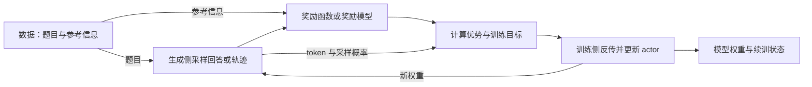

# 后训练 RL 框架：从训练闭环到 TRL、verl、OpenRLHF、slime 与 AReaL

把一份模型权重和一批题目交给框架，还没有定义一次强化学习训练。模型怎样生成回答、谁给奖励、奖励怎样转成更新、更新后的参数何时用于下一批生成，都需要接起来。框架的差别首先体现在这些连接处。

同名训练器也不保证相同训练目标。`GRPOTrainer` 可以选择不同的损失聚合方式，名为 `train_ppo_ray` 的入口可以运行另一种优势估计。要读懂配置，必须同时看算法参数、版本和训练生成的部署方式。

## 一次在线后训练循环怎样发生

监督微调（SFT）从“题目—示范答案”中学习；DPO 使用同一问题下的偏好答案对。在线 RL 则在训练期间让当前策略自己生成回答，再利用反馈更新它。这里的策略就是正在学习的语言模型，配置中通常叫 actor 或 policy。

以数学题为例，一条训练记录存题目和参考答案。题目经过对话模板送入生成侧，参考答案留给评分器。生成侧对同一题采样若干回答，这一步叫 rollout；多轮 agent 的 rollout 还包含工具调用、环境返回和后续回答。奖励函数接收生成结果和参考答案，返回数值。它可以是 Python 规则、测试执行器或神经奖励模型，不必另有一个“奖励模型”进程。[TRL 方法说明](#source-trl)、[verl 数据接口](#source-verl)

奖励还不能直接反向传播进采样出的文字。训练侧要计算**优势**，即这次选择相对基线有多好，再用它调整生成这些 token 的概率。GRPO 通常以同一道题多个回答的奖励作相对比较，不另训价值模型；PPO 的常见 GAE 路径会使用 critic，估计后续回报作为基线。组内回答全对或全错时，纯粹依靠组内差异就没有区分信号。是否归一化、怎样处理这种组，仍由配方决定。[TRL GRPO](#source-trl)、[verl 角色判定](#source-verl)

更新时常见的 logprob 是已生成 token 概率的对数，用来计算新策略与采样策略的概率比；裁剪等机制限制一次更新的幅度。reference 是另一份参考策略，KL 项用来惩罚对它的偏离。它与 critic 的用途不同，也不一定始终启用。奖励回答“这份输出得到怎样的反馈”，损失函数则决定“怎样用反馈改变参数”。



图中箭头表示依赖关系。同步训练会收齐一轮生成、完成更新，再交回权重；异步训练可以让不同批次的阶段重叠。无论是否重叠，生成侧都需要获得更新后的参数，否则下一批仍来自旧策略。

### 配置中的资源为什么分成几组

训练需要梯度和优化器状态，生成需要保存已生成上下文的注意力键值缓存（KV cache）。这两种内存需求和计算节奏不同，所以训练与生成常使用不同引擎、不同并行布局。vLLM、SGLang 是生成引擎；FSDP、DeepSpeed、Megatron 提供训练分片或模型并行能力。它们与负责连接全循环的框架不处于同一层。DAPO、ProRL 是算法或训练配方，接在这些框架上，本身不是另一个框架。

读资源配置时，只需先抓住它如何切模型或样本：数据并行（DP）让多份模型处理不同样本；张量并行（TP）拆开层内计算；流水线并行（PP）把不同层放在不同设备上。FSDP 和 ZeRO 把参数、梯度或优化器状态分片，减少每张卡持有的训练状态。生成侧 TP 与训练侧 TP 可以不同，因此交接权重可能还需要重新切分。[verl 架构](#source-verl)、[OpenRLHF 同步](#source-sync)

训练和生成可以共置在同一组 GPU，也可以各占设备。共置时 offload 或 sleep 机制搬走、释放部分状态，让另一阶段使用显存；分离时两侧能独立安排资源，但需要传权重。**设备分离不等于异步**：即使各有一组 GPU，控制器仍可要求生成完成后才能更新。[TRL 配置](#source-trl)、[AReaL 异步](#source-areal)

batch 的单位也不能省略。slime 后文的脚本一次取 32 个提示，每题采 8 个回答，得到 256 条回答；这不等于 256 个提示。micro-batch 是一次前后向处理的一小批，梯度累积可以把若干小批合成一次优化器更新。回答长度不一时，即使回答条数相同，token 量也不同。一次 rollout 之后做几次更新，还取决于 mini-batch 切分和样本复用。[slime 脚本](#source-slime)

## TRL：在 Python 中接通数据与奖励

TRL 适合作为熟悉 Transformers、希望先验证奖励设计的入口：模型、数据集、训练参数、奖励函数都能从 Python 的 Trainer 调用看见。分布式启动与显存仍需安排，但第一次改任务时，可以先聚焦“数据列是否正确传到了奖励函数”。

以下固定 **TRL v1.16.0**。同版官方 GRPO 入门使用 `trl-lib/DeepMath-103K` 和 `Qwen/Qwen2.5-0.5B-Instruct`。数据的 `prompt` 负责生成输入，`solution` 供内置 `accuracy_reward` 使用；奖励函数读取对话形式的 `completions`，解析参考解与生成答案，再作数学等价验证。参考解无法解析时返回 `None`，不是把它当成模型答错。[教程与奖励实现](#source-trl)

下面沿用该入门入口，额外明确损失类型、输出位置与最终保存；这些修改用于说明接口，不是一组经过调优的训练参数：

```python
from datasets import load_dataset
from trl import GRPOConfig, GRPOTrainer
from trl.rewards import accuracy_reward

dataset = load_dataset("trl-lib/DeepMath-103K", split="train")
config = GRPOConfig(
    output_dir="outputs/trl-math",
    loss_type="grpo",
    beta=0.0,
)
trainer = GRPOTrainer(
    model="Qwen/Qwen2.5-0.5B-Instruct",
    args=config,
    reward_funcs=accuracy_reward,
    train_dataset=dataset,
)
trainer.train()
trainer.save_model("outputs/trl-math/final")
```

在安装该版及数学奖励依赖、配置好 Accelerate 的环境中，将脚本存为 `train_grpo.py`，训练入口为 `accelerate launch train_grpo.py`。换自己的数据时，保留 `prompt` 并将参考值放到奖励函数需要的列；自定义函数可接收 `completions` 及数据的其他列。模型名、`num_generations`、回答长度和训练 batch 要一起调整：该版要求有效 batch 能被每题回答数整除。[GRPOConfig](#source-trl)

这里显式写 `loss_type="grpo"` 很关键：v1.16.0 的默认值是 `dapo`。前者先按各条回答长度归一化，后者按有效 token 聚合；两者给长短回答的相对权重不同。`beta=0` 关闭 KL 项，在这版实现中不加载 reference。[配置定义](#source-trl)

保存间隔和 `output_dir` 控制训练检查点，`save_model` 输出用于加载的模型；续训还需要对应训练状态。导出后的独立评测要另定题集、模板、采样预算和判分规则。

更完整的项目入口是 Open R1 固定提交 `5b6ff22b3fb7aa069c54866e517f39dfc3160e09` 的 `src/open_r1/grpo.py`：它把数据转换、奖励注册、恢复、保存和可选评估接到 TRL。其历史 YAML 没有填写 `loss_type`，所以不能拿新版本默认值反推当时训练目标。复用这类项目时，项目提交、TRL 依赖和生效配置必须一起固定。[Open R1 配置与调用](#source-openr1)

## verl：从数据路由读懂一份分布式配方

verl 的入口更适合已经要调整优势估计、采样数量、奖励和多卡布局的实验。它以控制器连接数据流，允许训练与生成采用不同后端及并行方式；选择范围增加，也意味着启动脚本只是最终配置的一部分，必须连默认配置一起读。

以下固定 **verl v0.9.1**，使用 `examples/grpo_trainer/run_qwen3_4b_fsdp.sh`。它启动 `verl.trainer.main_ppo`，但显式设置 `algorithm.adv_estimator=grpo`；`main_ppo` 是入口名，不是本次一定使用 GAE 和 critic 的证据。该版 Quickstart 的 PPO 入门则是另一条路线，不宜把两者参数拼在一起。[入口、角色判定与脚本](#source-verl)

### 预处理决定了模型和评分器各拿到什么

`examples/data_preprocess/gsm8k.py` 将原始 GSM8K 题目加上末答案格式指令，构造成 `prompt`，从参考解的 `####` 后提取 `ground_truth`，写成训练与测试 Parquet。转换后的连接关系是：

```text
question → prompt → 生成侧
answer 的末答案 → reward_model.ground_truth → 评分器
data_source="openai/gsm8k" → 选择 GSM8K 评分实现
extra_info → 保留原题、原解和切分信息
```

这里的 `reward_model.style="rule"` 表示规则反馈，不是要求加载神经奖励模型。默认 GSM8K 评分只在生成文本最后 300 个字符中找最后一个 `#### 数字`，与参考值字符串比较；正确给 1，否则默认给 0。若换成 boxed 输出却保留这份评分器，奖励可能一直为零，问题出在接口约定而非优化器。[预处理与评分实现](#source-verl)

在检出 v0.9.1、使用该版锁文件与依赖的仓库根目录，入口是：

```bash
uv run --frozen --all-packages --extra vllm --extra fsdp \
  python3 examples/data_preprocess/gsm8k.py --local_save_dir "$HOME/data/gsm8k"

PROJECT_NAME=gsm8k_grpo EXPERIMENT_NAME=qwen3_4b \
  bash examples/grpo_trainer/run_qwen3_4b_fsdp.sh \
  'trainer.logger=[console]'
```

第二条保留官方脚本的执行方式，只替换实验名和日志设置。脚本通过 `uv run` 启动 driver，也为 Ray worker 设置相应依赖环境；仅给主进程装包还不够。Ray 负责把组件分配到资源，Hydra 负责合并默认项与命令行覆盖。[同版脚本](#source-verl)

| 先改的配置 | 这条 GRPO 路线中的含义 |
| --- | --- |
| `MODEL_PATH`、`TRAIN_FILE`、`TEST_FILE` | 模型和训练、验证文件；验证文件仍须与训练用途区分 |
| `NNODES`、`NGPUS_PER_NODE` | 默认单节点、每节点 8 GPU；这不是显存实测或最低卡数 |
| `TRAIN_BATCH_SIZE`、`ROLLOUT_N` | 默认 512 个提示、每题 5 个回答 |
| `PPO_MINI_BATCH_SIZE`、每卡 micro-batch | 默认 256 与 2；脚本开启动态 token batching，实际计算量还受长度影响 |
| actor KL 与 reward KL | actor KL loss 开启、系数 0.001；reward 中的 KL 关闭，不能只记“用了 KL” |
| `SAVE_FREQ`、`TEST_FREQ` | 默认每 20 步保存、每 5 步验证 |

该路线用 FSDP 更新、vLLM 生成，生成侧 TP 为 2，提示和回答长度上限各 1024。换奖励时，应沿 reward 配置或评分分派接入新实现；不能只改数据路径而保留旧 `data_source` 和标签语义。[脚本与奖励分派](#source-verl)

默认模型训练产物在 `checkpoints/<project_name>/<experiment_name>` 下。分片检查点服务于训练保存与恢复，供推理加载的 HF 权重可用同版 `verl.model_merger` 合并。例如，确认实际生成了某一步的 actor 目录后，执行以下形式；`ACTOR_DIR` 是该目录变量：

```bash
uv run --frozen --all-packages --extra vllm --extra fsdp \
  python3 -m verl.model_merger merge --backend fsdp \
  --local_dir "$ACTOR_DIR" --target_dir outputs/verl-qwen3-4b-hf
```

合并只改变分片格式。导出后仍要核对 tokenizer 和对话模板。[导出接口](#source-verl)

## OpenRLHF：组件部署与算法配置要一起读

OpenRLHF 通过 Ray 编排组件，由 DeepSpeed 更新、vLLM 生成。已有 Ray/DeepSpeed 经验、需要分别管理 actor、reference 和生成资源时，可以从组件配置进入。下面使用固定提交 `dc2a7ad326f619fc5a47737ea47d1920ce2c0b53` 的 ProRL v2 数学脚本；这里的 ProRL 是配方，OpenRLHF 才是执行框架。[脚本](#source-openrlhf)

真实入口为 `bash examples/scripts/train_prorlv2_math_hybrid_engine.sh`，它调用 `python3 -m openrlhf.cli.train_ppo_ray`。脚本使用 DeepSeek-R1-Distill-Qwen-1.5B 和 `OpenRLHF/dapo-math-17k`，数据列为 `prompt`、`label`，并应用 chat template。换任务先改顶部 `MODEL_PATH`、`DATASET_PATH`、`REWARD_FUNC_PATH`、`SAVE_PATH`，再核对输入列、答案列和资源参数。该提交使用点号形式的参数，不应混入旧版扁平 flag。

`--reward.remote_url` 在这份脚本里指向本地 `examples/python/math_reward_func.py`，名字并不意味着它一定是 HTTP 服务。其接口 `reward_func(queries, prompts, labels, **kwargs)` 从完整序列中取出回答，抽取 boxed 答案并判等，返回 `rewards`、`scores` 和 `extra_logs`。同一答案若只写在 `####` 后，不能照搬 verl 的评分预期。[奖励实现](#source-openrlhf)

这条配方显式设置 `--algo.advantage.estimator reinforce_baseline`、KL loss 与 `k2` 估计器，并开启动态过滤。虽然入口带 PPO，也不能将整条路线称为原始 PPO 或原始 GRPO。actor 与 reference 都写为单节点各 8 GPU，vLLM 为 8 个 TP1 引擎，同时启用 `--train.colocate_all`；这是共享设备的组件部署描述，不能机械相加为 24 张 GPU。脚本末尾的异步参数处于注释中，因此这条具体入口没有启用它。[完整脚本](#source-openrlhf)

保存也有不同产物：`ckpt.output_dir` 接收最终模型，`ckpt.path/_actor` 保存训练状态，周期 HF 快照使用 `<tag>_hf` 目录。恢复需要相应状态及加载选项，仅留最终模型不足以恢复原来的优化过程。[actor 保存实现](#source-openrlhf)

同名配方的工程介绍与脚本还存在实质差异：NVIDIA ProRL v2 工程文讲周期性的长度惩罚与 reference reset；这份脚本没有启用注释中的 overlong 参数，也没有写出那条 reference reset 日程。脚本实际启用的截断惩罚系数为 0，使被长度上限截断的样本奖励归零。[ProRL 工程文](#source-prorl)、[脚本](#source-openrlhf)

## slime：权重格式是训练入口的一部分

slime 的这条路线以 Megatron 训练、SGLang 生成。已经在使用这两套后端、需要修改模型并行或 rollout 的团队，可以从它进入；第一次迁入模型时，难点往往先在模型结构参数与权重格式，而非奖励函数。

以下固定 **slime v0.4.0** 的 `scripts/run-qwen3-4B.sh`。模型参数文件 `scripts/models/qwen3-4B.sh` 描述层数、隐藏维度和注意力等结构；HF 模型目录提供配置和 tokenizer，训练需要的参考权重则通过 `tools/convert_hf_to_torch_dist.py` 转为 Megatron `torch_dist`。[快速开始、模型文件与转换工具](#source-slime)

在匹配该版本后端和补丁的环境里，Qwen3-4B 的权重准备形式如下，路径对应官方训练脚本：

```bash
source scripts/models/qwen3-4B.sh
PYTHONPATH=/root/Megatron-LM python tools/convert_hf_to_torch_dist.py \
  "${MODEL_ARGS[@]}" \
  --hf-checkpoint /root/Qwen3-4B \
  --save /root/Qwen3-4B_torch_dist
```

训练脚本的 `--hf-checkpoint`、`--ref-load`、`--load/--save` 分别指向 HF 配置目录、转换后的参考权重、训练检查点目录。准备数据时，训练 JSONL 用 `prompt` 和 `label` 列，官方路线采用 `zhuzilin/dapo-math-17k`，验证用 `zhuzilin/aime-2024`。`--input-key`、`--label-key` 和 `--apply-chat-template` 决定输入如何进入模型；改数据结构时要一起改。

这份脚本使用 `--rm-type deepscaler`，评分先取 `</think>` 后、或 `###Response` 后的回答，再抽答案并作数学判等。若两个标记都没有，直接给零。自定义奖励通过 `--custom-rm-path` 接入，应遵守同版 `async_rm(args, sample, **kwargs)` 的调用约定。[奖励分派与实现](#source-slime)

脚本一次生成 **32 提示×8 回答＝256 条回答**，`global-batch-size` 为 256，回答上限 8192；训练 TP2、PP1，生成引擎每个使用 2 GPU，训练生成共置。它探测可用卡数，探测失败回退到 8，这个回退值不能当最低硬件要求。完整入口是 `bash scripts/run-qwen3-4B.sh`，但原脚本开头会强制清理 Ray、SGLang 和 Python 进程，只适合专用训练容器；共享机器需要先移除这种全局清理。[训练脚本](#source-slime)

训练结果保存为 `/root/Qwen3-4B_slime/` 下的 Megatron 检查点，脚本每 20 轮保存。导出供 HF 使用的模型时，`tools/convert_torch_dist_to_hf.py` 接收实际迭代目录的 `--input-dir`、目标 `--output-dir`，并可通过 `--origin-hf-dir` 带入原始配置和 tokenizer。权重转换完成与训练恢复是两回事；保留训练分片，才能继续沿原训练后端恢复。[反向转换工具](#source-slime)

## AReaL：把 agent 的调用放进训练工作流

AReaL 值得从长短不一、含工具等待的轨迹进入：框架既提供训练与生成的组织方式，也提供 agent workflow，让调用生成、计算反馈和收集轨迹进入同一套训练。以下固定 **AReaL v2.1.0**，从单轮数学例子看接口，再讨论异步的含义。[配置与入口](#source-areal)

真实入口是：

```bash
python3 examples/math/gsm8k_rl.py \
  --config examples/math/gsm8k_grpo.yaml scheduler.type=local
```

这条命令在准备好该版环境后，从其仓库根目录执行。`gsm8k_rl.py` 加载 `GRPOConfig` 和 GSM8K 的 train/test，创建 `PPOTrainer`，将 `areal.workflow.openai.math_agent.MathAgent` 传给训练与验证。数据把题目转成用户消息、添加 boxed 答案指令，保留 `answer` 供奖励使用；`MathAgent` 调用 OpenAI 兼容客户端生成，再将回答与 `answer` 交给数学验证奖励。训练系统的代理把请求接回本地生成侧，因此客户端接口形式不等于在训练外部商业模型。[数据、MathAgent 与代理](#source-areal)

| 配置位置 | 这份 GSM8K YAML 连接的内容 |
| --- | --- |
| `actor.path` | Qwen/Qwen2.5-1.5B-Instruct；生成模型和 tokenizer 跟随配置 |
| `cluster`、actor/rollout backend | 单节点 8 GPU，训练 `fsdp:d4p1t1`、生成 `sglang:d4p1t1`，两侧各自有并行布局 |
| `train_dataset.batch_size`、`gconfig.n_samples` | 256 个训练提示，每提示 4 个回答；不是其他框架同名 batch 的替代值 |
| `actor.reward_norm`、`actor.adv_norm` | 奖励按组处理，优势另按 batch 处理；Trainer 名称不足以说明这些选择 |
| `rollout.max_head_offpolicyness` | 设为 2，对生成请求接纳施加策略版本约束 |
| `actor.use_decoupled_loss`、`actor.recompute_logprob` | 均开启，配合旧策略样本和训练侧概率计算 |
| `saver`、`recover` | 模型按 epoch 保存；恢复状态默认关闭 |

换模型先改 `actor.path`，换资源同时改集群和两侧布局。换任务则改数据、workflow 与奖励，并在新的交互里定义工具错误、超时、环境重置、哪些 token 参与学习，以及反馈看终局还是过程。单轮 GSM8K 只说明这组接口如何相接。

该版实际配置键是单数 `recompute_logprob`，与 YAML、配置类和 actor 一致；异步说明中的复数拼写不应直接复制进配置。模型保存由 Saver 管理，恢复由 RecoverHandler 管理，HF 模型不包含 optimizer；需要断点续训时必须启用并保留 recover 状态。更改 `cluster.fileroot`、实验名和 trial 名可以组织输出，但输出路径不替代恢复设置。[配置类与保存调用](#source-areal)

## 会改变配置读法的几项进展

### 生成与训练分离后，权重交接成为循环中的显式阶段

在一个 Python Trainer 里，生成与反传容易被理解成“同一个模型接着做两件事”。接入独立生成引擎后，实际上出现了两份运行中的参数表示。训练侧可能按 FSDP 或 Megatron 切分，生成侧按 TP 切分；更新结束还要把新参数送过去。verl 的多后端数据流、OpenRLHF 的 actor—vLLM 同步、slime 的 Megatron—SGLang 交接都在处理这个连接。[verl](#source-verl)、[同步说明](#source-sync)、[slime 入口](#source-slime)

部署方式改变具体动作。OpenRLHF 的早期同步文档分别写了 NCCL 传权重，以及共置 hybrid engine 的 CUDA IPC，两套都限于文档里的部署。slime v0.4.0 的训练入口则显式协调 rollout 暂停、权重更新与恢复，offload 情况下恢复 weights 与恢复 KV cache 是不同动作。判断某个阶段为什么耗时或内存上涨，需要区分载入参数、传输参数和恢复生成缓存。[SGLang 交接调用](#source-slime)、[OpenRLHF 同步](#source-sync)

这改变了“改卡数”的含义：设备布局既约束训练，也约束生成和交接；模型能在训练侧装下，不代表生成侧能容纳期望并发。

### 异步隐藏了等待，也让采样策略落后于训练策略

同步训练等最慢的一批生成完成，异步则允许训练消费队列里的样本，同时生成侧继续工作。这对长短差异大、工具返回慢的轨迹有吸引力，但队列里的回答可能来自旧权重，成为相对当前策略的偏策略数据。增加并发或队列深度，并不只改变吞吐，也会改变样本被用于更新时有多旧。

AReaL 的 `max_head_offpolicyness` 用于限制版本差异，设为 0 回到同步路线；大于零允许受限的落后。其 partial rollout 还允许一条轨迹分段跨越多个权重版本。此时给整条轨迹贴一个版本号已经不够，需要按实际生成片段理解采样概率。[异步文档](#source-areal)

重算 logprob 解决的是“用训练侧模型计算这段既有 token 的概率”，并不会重新抽样这些 token。策略版本滞后与训练、生成引擎的数值差异也是两件事：即使版本相同，不同实现仍可能给出不同概率。版本约束、解耦目标和重要性采样校正因此各有作用，不能用“同步过权重”替代全部处理。异步是否值得启用，要看真实等待和校正代价。[AReaL 配置](#source-areal)、[TRL 概率校正说明](#source-trl)

### 动态过滤使 batch 成为筛选后的结果

组内相对奖励遇到全对或全错时缺少区分信号。DAPO 的动态采样据此丢弃组内结果没有差异的提示，再继续采样，直到凑够训练所需的有效组。它改变了进入更新的数据分布，也让“训练 batch 大小”不再等于这一轮一共生成了多少题。[DAPO 方法](#source-dapo)

固定 `4f80e465c2ec79ab9c3c30ec74b9745de61d0490` 的 verl DAPO 脚本把训练提示设为 512、生成提示设为其三倍，即 1536，每题 16 个回答，最多尝试 10 批。生成成本要计入被丢弃的组，不能只用最后留下的提示数计算。这与前文 slime 不过滤的那份脚本中“32×8”的直接展开关系不同。[历史脚本](#source-dapo)

同一算法名也不能消除版本差异。DAPO 报告 v2 写 20 个 rollout step 的 warm-up，历史脚本写 `lr_warmup_steps=10`；计步口径未对齐时，不应把两个数改成一致。OpenRLHF 的 ProRL 脚本也开启动态过滤，但这不意味着它自动继承 DAPO 的损失、裁剪和 batch 定义。[报告与脚本](#source-dapo)、[OpenRLHF 配方](#source-openrlhf)

没有共同的模型、数据、奖励、长度、资源和生效损失，这五份入口说明不了吞吐。测到的差别可能来自配方。

## 来源与阅读范围

### TRL v1.16.0 {#source-trl}

[GRPO 教程](https://github.com/huggingface/trl/blob/v1.16.0/docs/source/grpo_trainer.md) · [GRPOConfig](https://github.com/huggingface/trl/blob/v1.16.0/trl/trainer/grpo_config.py) · [accuracy_reward](https://github.com/huggingface/trl/blob/v1.16.0/trl/rewards/accuracy_rewards.py) · [GRPOTrainer](https://github.com/huggingface/trl/blob/v1.16.0/trl/trainer/grpo_trainer.py)。支撑 DeepMath 入口、奖励传参、组内优势、loss 默认值与聚合差异、KL、vLLM 部署及概率校正。

### verl v0.9.1 {#source-verl}

[Quickstart](https://github.com/verl-project/verl/blob/v0.9.1/docs/start/quickstart.rst) · [GSM8K 预处理](https://github.com/verl-project/verl/blob/v0.9.1/examples/data_preprocess/gsm8k.py) · [奖励分派](https://github.com/verl-project/verl/blob/v0.9.1/verl/utils/reward_score/__init__.py) · [GSM8K 评分](https://github.com/verl-project/verl/blob/v0.9.1/verl/utils/reward_score/gsm8k.py) · [GRPO 脚本](https://github.com/verl-project/verl/blob/v0.9.1/examples/grpo_trainer/run_qwen3_4b_fsdp.sh) · [入口](https://github.com/verl-project/verl/blob/v0.9.1/verl/trainer/main_ppo.py) · [角色判定](https://github.com/verl-project/verl/blob/v0.9.1/verl/trainer/ppo/utils.py) · [模型合并](https://github.com/verl-project/verl/blob/v0.9.1/verl/model_merger/__main__.py)。支撑 PPO 与 GRPO 路线区别、数据到奖励的连接、资源参数、启动与分片导出。架构背景另见[固定 README](https://github.com/verl-project/verl/blob/5b550b0c3dad8c7bb7aab834a3fe195f8cdfc517/README.md)。

### Open R1 固定项目提交 {#source-openr1}

[grpo.py](https://github.com/huggingface/open-r1/blob/5b6ff22b3fb7aa069c54866e517f39dfc3160e09/src/open_r1/grpo.py) · [历史 YAML](https://github.com/huggingface/open-r1/blob/5b6ff22b3fb7aa069c54866e517f39dfc3160e09/recipes/Qwen2.5-1.5B-Instruct/grpo/config_demo.yaml)。支撑 TRL 项目的数据、奖励、保存调用及未显式填写损失类型的版本问题。

### OpenRLHF 固定 ProRL 脚本提交 {#source-openrlhf}

[训练脚本](https://github.com/OpenRLHF/OpenRLHF/blob/dc2a7ad326f619fc5a47737ea47d1920ce2c0b53/examples/scripts/train_prorlv2_math_hybrid_engine.sh) · [奖励函数](https://github.com/OpenRLHF/OpenRLHF/blob/dc2a7ad326f619fc5a47737ea47d1920ce2c0b53/examples/python/math_reward_func.py) · [CLI](https://github.com/OpenRLHF/OpenRLHF/blob/dc2a7ad326f619fc5a47737ea47d1920ce2c0b53/openrlhf/cli/train_ppo_ray.py) · [actor 保存](https://github.com/OpenRLHF/OpenRLHF/blob/dc2a7ad326f619fc5a47737ea47d1920ce2c0b53/openrlhf/trainer/ray/ppo_actor.py)。支撑数据列、boxed 奖励、实际优势配置、共置、动态过滤、截断处理和模型/续训产物。

### ProRL v2 工程文 {#source-prorl}

[NVIDIA 开发者文章](https://developer.nvidia.com/blog/scaling-llm-reinforcement-learning-with-prolonged-training-using-prorl-v2/)。支撑长度惩罚和 reference reset 的配方说明，与上述脚本区别对待。

### OpenRLHF—vLLM 权重同步 {#source-sync}

[vLLM 官方工程文，2025-04-23](https://vllm.ai/blog/2025-04-23-openrlhf-vllm)。支撑其部署条件下的 NCCL 与 CUDA IPC 同步路线，不指定后续所有版本的默认协议。

### slime v0.4.0 {#source-slime}

[Quick Start](https://github.com/THUDM/slime/blob/v0.4.0/docs/en/get_started/quick_start.md) · [Qwen3-4B 脚本](https://github.com/THUDM/slime/blob/v0.4.0/scripts/run-qwen3-4B.sh) · [模型参数](https://github.com/THUDM/slime/blob/v0.4.0/scripts/models/qwen3-4B.sh) · [训练入口](https://github.com/THUDM/slime/blob/v0.4.0/train.py) · [HF 转换](https://github.com/THUDM/slime/blob/v0.4.0/tools/convert_hf_to_torch_dist.py) · [HF 导出](https://github.com/THUDM/slime/blob/v0.4.0/tools/convert_torch_dist_to_hf.py) · [奖励分派](https://github.com/THUDM/slime/blob/v0.4.0/slime/rollout/rm_hub/__init__.py) · [deepscaler 奖励](https://github.com/THUDM/slime/blob/v0.4.0/slime/rollout/rm_hub/deepscaler.py)。支撑模型准备、数据字段、格式约定、batch 与资源、权重交接和检查点转换。

### AReaL v2.1.0 {#source-areal}

[GSM8K YAML](https://github.com/areal-project/AReaL/blob/v2.1.0/examples/math/gsm8k_grpo.yaml) · [训练入口](https://github.com/areal-project/AReaL/blob/v2.1.0/examples/math/gsm8k_rl.py) · [数据转换](https://github.com/areal-project/AReaL/blob/v2.1.0/areal/dataset/gsm8k.py) · [MathAgent](https://github.com/areal-project/AReaL/blob/v2.1.0/areal/workflow/openai/math_agent.py) · [代理工作流](https://github.com/areal-project/AReaL/blob/v2.1.0/areal/experimental/openai/proxy/workflow.py) · [异步机制](https://github.com/areal-project/AReaL/blob/v2.1.0/docs/en/algorithms/async.md) · [配置类](https://github.com/areal-project/AReaL/blob/v2.1.0/areal/api/cli_args.py) · [actor](https://github.com/areal-project/AReaL/blob/v2.1.0/areal/trainer/ppo/actor.py) · [保存调用](https://github.com/areal-project/AReaL/blob/v2.1.0/areal/trainer/rl_trainer.py) · [Saver](https://github.com/areal-project/AReaL/blob/v2.1.0/areal/utils/saver.py) · [RecoverHandler](https://github.com/areal-project/AReaL/blob/v2.1.0/areal/utils/recover.py)。支撑训练入口、消息与奖励、两侧布局、版本限制、partial rollout、配置键与模型/恢复状态的区别。

### DAPO 方法与历史配方 {#source-dapo}

[报告 v2](https://arxiv.org/html/2503.14476v2) · [verl 固定脚本](https://github.com/verl-project/verl/blob/4f80e465c2ec79ab9c3c30ec74b9745de61d0490/recipe/dapo/run_dapo_qwen2.5_32b.sh)。支撑动态采样、生成与训练 batch 区别，以及 warm-up 设置差异；该历史脚本不与 v0.9.1 的环境或默认值混用。
