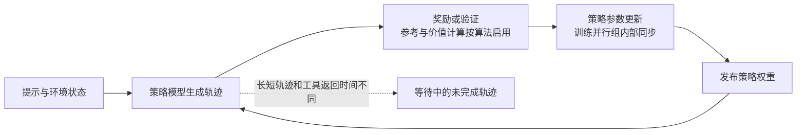

# 大模型后训练的集群调度：设备放置、通信约束与失败恢复

大模型后训练放进大规模 GPU 集群后，调度的对象并不是一堆可以互换的 GPU 槽位。**需要共同计算的设备，必须放进能完成通信、能保持状态一致、也能在中断后重新组织起来的一组资源里。** 在线强化学习又增加了一层困难：生成样本和更新参数的速度不同，同一批回答的完成时间不同，策略、参考模型和奖励模型也不必占用同一组设备。让更多 GPU 保持忙碌，有时反而会让训练消费更多过时样本，或付出更高的权重搬运成本。[ReaL](https://proceedings.mlsys.org/paper_files/paper/2025/file/3b3889d313ba9476c12c2d77ea66b24f-Paper-Conference.pdf)、[AReaL](https://arxiv.org/html/2505.24298v1)

理解这些系统，可以沿着三个相连的决定展开：**哪些设备放在一起，它们之间的通信经过什么网络，等待、抢占或失败后哪些计算还能继续。** 前两个决定规定一次计算能否高效推进，第三个决定已经花掉的计算是否还能保留。以下先解释这些决定依赖的网络与分布式事实，再讨论后训练改变了什么。

## 网络先决定：空闲 GPU 是否真能组成一个作业

### 同样数量的 GPU，可能跨过不同的通信边界

一台多 GPU 服务器内部，设备可能通过 NVLink、NVSwitch 或 PCIe 连接；跨服务器则要经过网卡和交换机。这里需要记住的不是某代硬件的峰值带宽，而是**机内与机间通信的代价往往不同**。Megatron-LM 的 2021 年预训练研究因此把频繁交换中间结果的张量并行优先放在机内，再用流水并行跨服务器扩展。这个放置理由可以沿用到采用相同并行方式的后训练更新阶段，但其预训练扩展结果不能直接充当后训练的吞吐结果。[Megatron-LM，§2–3](https://people.eecs.berkeley.edu/~matei/papers/2021/sc_megatron_lm.pdf)

跨机网络也不是一个均匀的带宽池。交换机如何连接、服务器的多个网口接到哪里，是两个不同的问题：

| 网络结构或连接方式 | 需要理解的事实 | 对放置的实际约束 |
| --- | --- | --- |
| **Fat-tree／Clos 类多级网络** | 通过多级交换与多条路径连接服务器。Al-Fares 等在 2008 年的 fat-tree 设计追求用商用交换机提供全聚合带宽；实际部署是否过订阅，仍取决于上联容量和布线。过订阅指下游同时发送的总需求可能超过上联承载能力。 | 跨交换机通信不一定必然慢；但若一组通信必须穿过同一条受限上联，分散到更多服务器会增加争用。不能只凭“同一集群”就假定任意设备之间等价。 |
| **Rail-optimized 连接** | 将多网口 GPU 服务器的不同网口接入不同的 leaf，也就是靠近服务器的第一层交换机，使不同服务器上对应位置的网口沿相应 rail 通信。它可与 fat-tree 同时存在，并非另一种传输协议。 | GPU、网卡和通信进程之间的映射要与布线相符。同样一组服务器，不同映射可能利用不同的链路；把作业放到服务器上，还没有完成通信放置。 |

依据：[Fat-tree，§2–3](https://www.cs.princeton.edu/courses/archive/fall10/cos597B/papers/fattree-sigcomm08.pdf)、[NVIDIA 集群拓扑说明](https://docs.nvidia.com/networking/display/infiniband-cluster-bring-up-procedure.pdf)、[同时采用 fat-tree 与 rail 连接的官方架构说明](https://docs.nvidia.com/enterprise-reference-architectures/rtx-pro-ai-factory/latest/networking-physical-topologies.html)。

这里的“通信走什么网络”通常不是指集群调度器逐包选路。调度器决定服务器、GPU 组和可用网络域；通信运行时根据设备与网卡关系组织通信，网络再负责转发和拥塞控制。因而，拓扑感知放置要交给运行时一个合适的设备集合和映射，不能仅在分配结果里写“需要高速网络”。这是由上述拓扑结构和并行通信需求得到的工程归纳。

### RDMA 降低搬运开销，不保证通信永远不会等待

**RDMA，即远程直接内存访问**，让网卡直接在预先注册的内存区域之间传输数据，减少主机网络协议栈和 CPU 的参与。InfiniBand 是承载这类通信的一套专用网络技术；RoCEv2 则将 RDMA 传输承载在 Ethernet、IP 和 UDP 之上。二者是网络与传输层面的选择，不能与 fat-tree、rail 这样的拓扑或布线方式混为一谈。[DCQCN，§1](https://conferences.sigcomm.org/sigcomm/2015/pdf/papers/p523.pdf)

链路仍会拥塞。2015 年的 DCQCN 工作指出，RoCEv2 部署中用来避免丢包的 PFC（按优先级暂停上游发送）会带来队头阻塞：一个拥塞方向可能拖住共享同一暂停范围的其他流。DCQCN 利用交换机的 ECN 拥塞标记和接收端反馈，让发送网卡调整速率，减轻对暂停的依赖。它研究的是通用 RDMA 网络，不是后训练调度器；对这里有用的结论是，**网卡标称带宽不能当作作业独占的可用带宽**。若梯度同步、参数重分片和权重广播同时经过共享链路，调度估计需要考虑争用，不能假定它们仍分别享有孤立测速时的带宽。[DCQCN，§2–3](https://conferences.sigcomm.org/sigcomm/2015/pdf/papers/p523.pdf)

## 并行方式决定：哪些设备必须一起推进

分布式训练会给通信组中的进程分配编号，称为 **rank**。NCCL 这类通信库用 communicator 记录参与者，执行集合通信。所谓集合通信，是一组参与者共同完成一个数据交换或归约操作；各方必须按协议调用匹配的操作。少了一个成员，剩下的成员并不能自动把它当作“少了一点算力”。NCCL 明确要求各 rank 使用一致的数据元素数量、数据类型等，否则可能挂起或产生错误。[NCCL 集合通信文档](https://docs.nvidia.com/deeplearning/nccl/user-guide/docs/usage/collectives.html)

不同并行方式把不同的数据放进这个约束里：

| 并行方式 | 切开的是什么，主要通信是什么 | 为什么会改变设备放置与调度 |
| --- | --- | --- |
| **数据并行，DP** | 每个副本处理不同样本。普通复制式 DP 在更新前对梯度做 **all-reduce**：把各方对应位置的数值归约，再让各方拿到相同结果。 | 更新依赖整个同步组的贡献；某个副本慢，会延后这次共同更新。增加副本也会扩大同步范围。 |
| **分片数据并行** | ZeRO 一类方案把优化器状态、梯度乃至参数分散保存。**reduce-scatter** 先归约再把结果分给各方；**all-gather** 把各方分片收集到各参与者。 | 以通信换取显存容量。设备上可能只有部分参数和优化器状态，不能按“每张卡都有完整模型”的假设缩容或恢复；参数通信也不再只发生在更新末尾。 |
| **张量并行，TP** | 将同一层的矩阵计算切开。Megatron 的典型实现反复用 all-reduce 合并部分结果；其他分解也会使用 all-gather 和 reduce-scatter。 | 通信进入逐层计算路径，对延迟和带宽敏感。将同一 TP 组随意拆到远端节点，可能让每层都等待网络。 |
| **流水并行，PP** | 按层分成阶段，前向发送激活，反向发送相应梯度，主要是相邻阶段的**点对点通信**。多个微批次交错推进以填满流水线。 | 不要求每层所有设备互相交换，却依赖阶段顺序与速率匹配；阶段被抢占会堵住上下游，微批次不足时还会出现设备无事可做的流水空泡。 |
| **专家并行，EP** | 混合专家模型把专家放在不同设备，按路由结果分发 token、收回专家输出，常见核心模式是 **all-to-all**：每方给不同目的方发送不同数据。 | 同一组内有多对多交换，流量随 token 路由变化。只为规则的梯度归约优化放置，并不能保证专家分发也有足够链路容量。 |

机制依据：[Megatron-LM，§2–3](https://people.eecs.berkeley.edu/~matei/papers/2021/sc_megatron_lm.pdf)、[ZeRO，§5、§7](https://arxiv.org/html/1910.02054v3)、[GShard，§3.3、§5](https://arxiv.org/html/2006.16668v1)、[NCCL 操作定义](https://docs.nvidia.com/deeplearning/nccl/user-guide/docs/usage/collectives.html)。Megatron 与 ZeRO 在这里支撑通用大模型训练机制；GShard 原始实验使用 TPU，其 all-to-all 机制可用于理解专家分发，但 TPU 上的通信扩展曲线不等于 GPU 集群上的结果。

这解释了 **gang scheduling，成组调度** 的必要性：有相互依赖的一组 worker，必须拿到足以推进计算的整组资源，再开始执行；不能只分到一部分 GPU，就把等待中的其他成员视为以后可以随便补齐的独立任务。它要求的是资源和参与者的协同可用，并非每张 GPU 每一时刻都执行同一种指令。Tiresias 在 2019 年将这种 all-or-nothing 执行模型作为训练集群调度的基本约束。[Tiresias，§2–3](https://www.usenix.org/system/files/nsdi19-gu.pdf)

成组分配解决“能不能启动”，拓扑感知放置解决“启动后以什么速度推进”，两者不能互相替代。网络很好的零散空闲设备，可能凑不出合法的并行组；数量足够的一组设备，也可能被一条共享链路拖慢。下面后训练系统所调整的资源份额，都必须落回这些具体通信组。

## 后训练多出来的不对称：一个作业里有几种不同的时间

监督微调，以及数据固定的离线偏好优化，其参数更新仍可沿用上述训练并行方式。在线强化学习则要持续用策略模型生成轨迹——从提示到回答、或包含工具交互的一段行动序列——再根据奖励更新策略。生成会缓存此前 token 的注意力键和值，称为 **KV cache**，以避免每步重新计算前缀；回答越长，缓存占用越大，可同时容纳的请求越少。生成速度受这个容量、回答长度和外部环境响应影响；更新速度还取决于训练批次、反向计算与同步。PPO 工作流常有 critic 估计价值、参考模型计算约束、奖励模型打分，但具体算法不一定需要全部模型，规则验证奖励也可能主要消耗 CPU。[ReaL，§2、§7–8](https://proceedings.mlsys.org/paper_files/paper/2025/file/3b3889d313ba9476c12c2d77ea66b24f-Paper-Conference.pdf)、[AReaL，§6](https://arxiv.org/html/2505.24298v1)、[StreamRL，§2.1、§2.4](https://arxiv.org/html/2504.15930v1)

*机制示意：实线包含样本流和策略版本依赖，不表示所有步骤必须串行执行。生成组、评分组与更新组可以共享设备，也可以分离；组内的集合通信与组间的样本、权重传输是不同的网络负载。*

后训练因此同时存在三种等待：训练并行组内等待通信成员，更新器等待足量可训练样本，生成端等待新权重或外部环境。后两种不能仅靠加快 all-reduce 消除。反过来，把生成端做得更快，也可能只让旧策略样本堆在队列里。**异步调度需要同时管理资源和样本版本。** AReaL 将两者明确联系起来：控制生成请求的接纳和样本陈旧程度，并配合适合异步数据的训练目标，而非只把生成调用放到后台。[AReaL，§4–5](https://arxiv.org/html/2505.24298v1)

还要区分集群层与作业内调度。前者在多个作业之间分配、放置或收回设备，后者在已经分到的设备里安排生成、评分、更新和权重同步。AReaL 的论文实现构建在 ReaLHF 之上，由 Slurm 分配资源，内部再协调 SGLang 生成与 Megatron-Core 更新；这两层分工说明，使用某个 RL 框架，并不等于已经解决共享集群的排队、公平和抢占问题。[AReaL，§6](https://arxiv.org/html/2505.24298v1)

## 先分到一组设备：紧凑放置与弹性都有代价

对共享集群来说，强制每个作业占用尽可能少的服务器，能降低部分跨机通信，却也可能让作业一直等待整机空闲。Tiresias（2019）同时处理抢占优先级和放置：优先级考虑作业已获得的 GPU 数量与执行时间；放置则根据通信剖析判断哪些模型值得紧凑部署，其他作业可放宽约束以减少碎片。它改变的是“谁先拿到整组设备”和“是否值得等更紧凑的位置”。其放置判据来自当时 TensorFlow 参数服务器工作负载中的张量与消息偏斜，不能直接推广成今天 TP 或 EP 组的通用规则。[Tiresias，§3.2–3.3](https://www.usenix.org/system/files/nsdi19-gu.pdf)

弹性调度进一步问：一个作业是否应该一直占用最初申请的设备数？Pollux（2021）将同步数据并行作业的 GPU 数量、批量、梯度累积和学习率一起调整，用 **goodput** 同时衡量样本吞吐与样本带来的训练进展。它用保存训练状态的检查点（checkpoint）衔接重启，把重配置损失纳入分配决策，并限制分布式作业共享节点造成的网络干扰。这项通用训练工作提供了一个仍适用的判断：增加设备前要看增加的是有效训练进展，重新分配前要算回收成本。其原始吞吐模型面向同步 DP；后训练中策略版本、在线奖励和轨迹生成的影响，需要另建模型，不能直接套用原来的 goodput 估计。[Pollux，§3–4](https://www.pdl.cmu.edu/PDL-FTP/CloudComputing/osdi21-pollux.pdf)

沿用到后训练时，这两条思路各保留了一半：紧密通信的更新组仍需成组、拓扑合适地分配；相互独立的生成副本则更容易增减。**弹性的自然单位经常是一个完整生成副本或一个可重配置的训练组，而不是任意一张 GPU。** 这是从通信依赖得到的归纳，也解释了后面系统为何采用不同的扩缩容边界。

## 作业内如何分工：共置与分离回答的不是同一个问题

### 共置能省什么，参数重分片又要付什么

让生成与更新轮流使用同一组 GPU，可以避免一池生成时另一池完全闲置，也不必长期保留两套策略权重。但生成与训练适合的并行配置可能不同：训练要容纳激活、梯度和优化器，生成要容纳持续增长的 KV cache；相同设备集合不代表相同的参数分片。因此，共置仍可能需要在阶段之间重新分发参数。[HybridFlow，§2.3、§5](https://arxiv.org/html/2409.19256v2)

ReaLHF 的正式版 ReaL（预印本 2024，MLSys 2025）把资源决策细化到一次模型函数调用：策略生成、参考推断、奖励推断、策略更新等，可以分别选择 GPU 集合与并行方式，再用参数重分配衔接。运行时优先选择通信代价较低的源设备，减少不必要的远程搬运。它比“一个模型固定占一组 GPU”多解决了阶段之间的配置错配；但执行计划依赖剖析得到的调用代价，论文明确指出，剧烈变化的生成长度或不稳定集群会破坏这种预测假设。计划内的动态搬运不等于持续根据在线负载重新优化。[ReaL，§3、§5–7](https://proceedings.mlsys.org/paper_files/paper/2025/file/3b3889d313ba9476c12c2d77ea66b24f-Paper-Conference.pdf)

HybridFlow（预印本 2024，EuroSys 2025）则用分层控制表达 RL 数据流，并让模型内部的分布式计算自行推进；其 3D-HybridEngine 重点调整训练与生成的通信组映射，使设备能复用已有权重，降低转换中的冗余显存与通信。它同时搜索不同模型的设备放置，而不是预先认定所有角色都应共置。[HybridFlow，§4–6](https://arxiv.org/html/2409.19256v2)

### 规模扩大后，为什么分离可能更合适

这里有两条必须分开的切分轴：一条把策略、critic、参考和奖励模型放在不同资源上；另一条把**同一个策略的生成与更新**分开。HybridFlow 的四模型放置比较与 StreamRL 的生成／更新分离，涉及这两条不同的轴，不能只看文中出现了 split 或 disaggregation 就当作同一种方案。

HybridFlow 的 PPO 放置实验已经说明，共置的优劣依赖规模：在其 A100 集群、节点间 200 Gbps 网络、同尺寸 13B 模型设置中，各模型组合 TP、PP、DP 执行；16–64 张 GPU 时全部模型共置最好，到 128 张 GPU，策略、critic、参考与奖励各自部署的配置更好，分别分配 64、32、16、16 张卡。论文给出的解释是，固定批量继续扩大同一模型的 DP 组，会降低计算与通信之比；分开不同模型，反而可以用较小的并行组并发执行。该实验统一固定了提示与生成长度，不能单独回答长短回答不齐时如何调度；卡数上的交叉也不是通用分离门槛。[HybridFlow，§8.1–8.3](https://arxiv.org/html/2409.19256v2)

StreamRL（2025 年预印本）从生成／更新分离出发，允许两池选择不同数量与类型的 GPU，以流式返回已完成样本来重叠后续工作。它还区分网络边界：同一 RDMA 网络内用多棵广播树分发权重；跨机房时先把权重发送到远端一个指定实例，再在当地广播，避免每个副本都独立跨机房拉取。这样切开的是两池之间的流量，训练组内部的频繁集合通信仍留在训练侧。[StreamRL，§3–4、§6](https://arxiv.org/html/2504.15930v1)

其部署实验也保留了这条边界：训练侧组合 TP、PP、DP，生成侧运行独立副本；同机房测试使用 128 张 H800，网络为 rail-optimized RoCEv2，异构测试另用 32 张 H20 组成生成资源，H20 节点间是 TCP 网络，两集群用专线相连。它检验的是分离后能否利用不同网络和设备池，并非证明可以把同一 TP 组跨机房展开。吞吐比较还按给定回答的长度控制各系统的输出，以隔离负载差异；这种对照保留了长尾分布，却不等于验证策略持续变化时长度预测始终准确。分离是否划算，还取决于权重更新的频率、跨池传输能否被重叠，以及两侧是否真正平衡。[StreamRL，§6–7](https://arxiv.org/html/2504.15930v1)

所以，共置与分离的分歧不应收成架构排名。共置在资源较少、同步依赖强、复制和搬运昂贵时有直接收益；分离在两阶段资源需求不同、能够重叠或需要利用异构资源时扩大了选择空间。这个归纳同时要求计算**阶段内通信、阶段切换和跨池权重发布**，少算其中任何一项都可能改变结论。

## 长短轨迹不齐：是等、打断，还是搬走剩下的工作

### 少数长回答会同时拖住批次和设备

同步生成中，短回答结束后留下的 GPU 容量，不一定能推动下一次参数更新，因为更新仍可能等待本批最长回答。生成器内部即便使用连续批处理，也不自动消除训练批次的依赖。StreamRL 让完成的样本立即流向参考计算、奖励与其他后续步骤；不过，样本级计算可以提前执行，不代表算法允许在所需批次尚未形成时任意更新策略。[StreamRL，§4.1](https://arxiv.org/html/2504.15930v1)

长尾本身还有不同的处理目标。StreamRL 用输出长度排序模型预判长轨迹，将它们分给较小批量的实例，并优先启动预计更长的样本，目标是缩短本批最后完成的时间。Laminar（2025 年预印本）面对的则是生成后期只剩少数轨迹、解码批量很小的副本：它按权重版本分组，把未完成轨迹集中到少数副本，释放其他副本去取新权重、产生新样本。在小批量区间，合并后单步解码延迟增加有限，因而可以提高资源利用率。[StreamRL，§5](https://arxiv.org/html/2504.15930v1)、[Laminar，§2.4、§5](https://arxiv.org/html/2510.12633v1)

二者并不支持“长样本统一使用大批量”或“统一使用小批量”。前者避免长轨迹被大批量拖慢，依赖长度排序和延迟估计；后者利用已经出现的尾部空闲，依赖同版本副本和可迁移的轨迹状态。它们调整的是不同阶段的瓶颈。长度预测失准会影响前者的分派；可用的同版本接收副本不足，则会限制后者的合并。

### 异步后还要决定：一条轨迹能不能跨策略版本

更新器和生成器并发后，训练用到的数据可能由较旧策略产生，这称为策略陈旧或 policy staleness。若换新权重时还必须等待所有长轨迹结束，全局等待就会重新出现。AReaL（2025）选择可中断生成：暂停未完成请求，更新权重，丢弃旧 KV cache 并用新权重重算前缀，再继续生成；因此一条轨迹的不同片段可能来自不同策略版本，也要支付前缀重算成本。它配套区分采样行为策略与约束当前更新的近端策略，并控制陈旧程度，不能仅把其中断机制接到原样的同步 PPO 目标上，就假定学习行为不变。[AReaL，§4–5](https://arxiv.org/html/2505.24298v1)

Laminar 保留另一种取舍：单条轨迹保持策略版本一致，副本完成自身批次后独立取新权重，并通过同版本轨迹重排释放副本。其 CPU relay 在主机内存缓存权重，通过 RDMA 分发，再供本地生成器拉取，避免让每个生成副本的取权重时刻都成为训练 GPU 的全局同步点。代价是主机内存、广播服务以及旧版本轨迹的管理。[Laminar，§3–5](https://arxiv.org/html/2510.12633v1)

这是真实的算法与系统取舍。AReaL 的机制需要处理跨版本采样；Laminar 的机制需要处理持续运行的旧版本副本。Laminar 与 AReaL 的论文对照还使用了不同生成和训练后端，不能将端到端差异全归因于是否保持单轨迹版本一致。AReaL 自身的消融则表明，仅提高异步程度而不配合目标和陈旧控制，会损害训练表现；“GPU 更忙”并不能单独证明后训练更快到达目标能力。[AReaL，§7.4](https://arxiv.org/html/2505.24298v1)、[Laminar，§8](https://arxiv.org/html/2510.12633v1)

### 资源比例也会随训练改变

生成逐渐变长时，最初平衡的两池可能重新失衡。StreamRL 通过增加完整生成 DP 单元扩展生成池；它没有对训练池采用同样的无缝扩容，因为改变训练并行配置需要重建运行时。DynaRL（OSDI 2026）进一步把运行中的组件依赖、队列和资源状态表示为动态超图，将资源从过量配置的组件移向瓶颈；但迁移受组件可中断点约束，并需处理参数、优化器状态与新通信组，而不是看到利用率低就直接回收 GPU。[StreamRL，§4.2](https://arxiv.org/html/2504.15930v1)、[DynaRL，§4–5](https://www.usenix.org/system/files/osdi26-wang-yuanqing.pdf)

DynaRL 的实验比较动态资源调配与固定配置的 RL 框架，在 H100、机内 NVLink、机间 RoCEv2 的集群上使用 SGLang 与 Megatron 后端，覆盖数学和多轮工具交互；它的训练与生成 TP 配置也不同。这支持“固定比例可能错过运行中瓶颈变化”的判断，却没有取消底层成组通信约束。动态策略能移动资源，前提是执行引擎提供相应迁移接口与安全边界。[DynaRL，§6–7](https://www.usenix.org/system/files/osdi26-wang-yuanqing.pdf)

## 抢占与失败：需要恢复的是哪一种状态

计划内抢占可以等待一个安全点，故障则可能直接切断正在进行的集合通信。二者都不能只解释为“把进程挪到别处”。例如，部分 rank 已完成梯度计算、另一些 rank 在通信中失效，剩下的设备不能把不完整的结果当成一次成功更新；网络恢复也不会自动证明这一步参数状态一致。[NCCL 错误处理文档](https://docs.nvidia.com/deeplearning/nccl/user-guide/docs/usage/communicators.html)

NCCL 2.32.3 文档已提供中止、重建 communicator，以及用 `ncclCommShrink` 排除失败 rank 的能力。因此，不能沿用旧系统中的概括，说 NCCL 一概无法处理成员变化。但**通信参与者重建与训练状态恢复是两件事**：新通信组能够交换数据，不意味着丢失的参数分片、优化器动量或未提交更新已经恢复。分片训练需要从检查点、其他保存副本或明确的状态迁移协议补回这些内容；这是通信接口与 ZeRO 状态结构共同给出的边界。[NCCL communicator 与容错](https://docs.nvidia.com/deeplearning/nccl/user-guide/docs/usage/communicators.html)、[ZeRO，§5](https://arxiv.org/html/1910.02054v3)

| 被中断的对象 | 继续执行所需的状态 | 能否只影响局部 |
| --- | --- | --- |
| **参数更新组** | 一致的模型、优化器与训练进度；新设备上的分片映射及通信组。用于生成的权重快照不能替代训练检查点。 | 固定并行配置常通过 checkpoint 后重启恢复；要局部调整，运行时必须显式重分片并重建组。 |
| **生成副本** | 提示、已生成 token、所用策略版本；执行环境状态视任务而定。KV cache 丢失后可能需要重新计算前缀。 | 副本之间没有必要共同重启，但前提是权重传输和任务管理没有把它们绑进一个不可分割的失败域。 |
| **权重发布链路** | 已完成发布的版本、分片完整性，以及接收方何时启用它。 | 可以独立修复广播或重试传输；不能让接收方把不完整的新权重当作可用版本。 |

表中训练与生成边界依据：[DynaRL，§4.2、§6](https://www.usenix.org/system/files/osdi26-wang-yuanqing.pdf)、[Laminar，§3.3–4.3](https://arxiv.org/html/2510.12633v1)。这是按状态依赖作的归纳，不表示每个框架都已实现所有恢复路径。

DynaRL 的计划内迁移采用先建立新 worker、传完状态并确认、再切换活动集合的做法；传输失败则放弃新集合，保留原来的状态。它解决的是“资源重分配怎样不破坏正在运行的训练”。这个过程依赖旧成员仍然可用，不能据此推导已丢失分片也能用同一路径找回。[DynaRL，§4.2](https://www.usenix.org/system/files/osdi26-wang-yuanqing.pdf)

Laminar 则将生成中间状态放入独立的 partial response pool；生成副本失败后，把轨迹交给相同权重版本的健康副本，训练端可继续消费其他完成样本。其故障实验使用 Qwen2.5-32B、128 张 H800，其中训练与生成各占 64 张，生成副本采用 TP=4，节点间带宽为每节点 8×400 Gbps；杀掉一台承载两个生成副本的机器后，剩余训练继续，包含申请替代机器和初始化的恢复约需 252 秒。这说明隔离了生成故障的影响范围，不是零损失或零时间恢复；训练端失败仍走检查点恢复。[Laminar，§3.3、§8.4–8.5](https://arxiv.org/html/2510.12633v1)

从这些机制可以推得，后训练抢占应区分状态：能独立恢复的生成副本通常比参数分片更新组更容易回收，但长轨迹已经积累的工作也可能很贵。只按显存占用、当前利用率或进程数量决定受害者，会漏掉恢复代价。策略版本越旧，保留这些轨迹的价值还越依赖训练算法；checkpoint 间隔、抢占优先级和陈旧控制因此不能各自独立设定。

## 可以据此判断什么，证据还不能合并什么

一个可执行的后训练调度判断，应先确定通信组的边界，再判断阶段之间是否值得共享设备，最后确定资源调整时能保存什么状态。以下是上述材料支持的条件化归纳：

- **更新组逐层通信密集时，先保护组内拓扑。** 生成池的弹性不能通过随意拆散 TP 或 EP 组来实现；同一节点上的空闲 GPU，也不代表还有足够网络余量承接另一个分布式作业。
- **生成、更新的资源需求不同且能重叠时，分离扩大了调度空间。** 若两阶段仍完全串行，又没有异构资源收益，分离本身只增加一项需要支付的权重传输。
- **少量长轨迹占住大量副本时，调整任务比继续加卡更直接。** 长度分派、轨迹合并和可中断生成分别改变完成顺序、设备占用和策略版本，选择前必须明确算法允许哪一种变化。
- **需要频繁迁移时，先看运行时能迁移什么。** 仅支持 checkpoint 后重启的训练组，与支持状态转移和通信组重建的训练组，不应使用相同的调度周期。

这些判断没有形成一个跨系统的性能排行榜。ReaL 主要比较函数调用级资源计划，HybridFlow 比较角色放置和并行组转换，StreamRL 比较分离流水与长尾分派，AReaL 联合改变异步采样和训练目标，Laminar 检验轨迹级异步及故障隔离，DynaRL 检验在线资源迁移。它们的 GPU、网络、后端和算法条件不同，最大加速比不能拼成一条规模扩展曲线。

仍需保留三个具体边界。第一，Tiresias、Pollux 的共享集群目标与 RL 框架内部的吞吐目标不同；单个后训练作业更快，不证明多租户下排队、公平和抢占总损失更小。第二，密集模型的规则通信结论不能覆盖 MoE 后训练中随路由变化的 all-to-all；还需要把专家负载、网络拥塞与生成长度变化放进同一个实验。第三，生成副本故障隔离不等于整个后训练数据流具有恰好一次消费语义；多轮工具调用还涉及外部状态与副作用，缓存 token 和策略权重并不足以证明重试完全等价。

这些边界决定了“大规模”的含义：不只是更多设备，而是更多通信参与者、更多独立完成的轨迹，以及更多可能在不同时间失效的状态。调度器若仍只看 GPU 数量，就看不到其中任何一个等待与恢复边界。

## 来源与阅读范围

- **Al-Fares、Loukissas、Vahdat，2008，SIGCOMM**：[A Scalable, Commodity Data Center Network Architecture](https://www.cs.princeton.edu/courses/archive/fall10/cos597B/papers/fattree-sigcomm08.pdf)。正式论文；支撑 fat-tree、多路径、聚合带宽与过订阅的区别。
- **NVIDIA 官方网络文档**：[InfiniBand Cluster Bring-up Procedure](https://docs.nvidia.com/networking/display/infiniband-cluster-bring-up-procedure.pdf)，Cluster Planning／Setting the InfiniBand Cluster Topology；[Networking Physical Topologies](https://docs.nvidia.com/enterprise-reference-architectures/rtx-pro-ai-factory/latest/networking-physical-topologies.html)，页面更新于 2026-05-18。支撑 rail 端口连接与 fat-tree 可同时采用；不用于产品性能比较。
- **Zhu 等，2015，SIGCOMM**：[Congestion Control for Large-Scale RDMA Deployments](https://conferences.sigcomm.org/sigcomm/2015/pdf/papers/p523.pdf)。正式论文，§1–3；支撑 RDMA、InfiniBand、RoCEv2、PFC 与 DCQCN 的机制。
- **NCCL 2.32.3 官方文档**：[Collective Operations](https://docs.nvidia.com/deeplearning/nccl/user-guide/docs/usage/collectives.html)、[Creating a Communicator](https://docs.nvidia.com/deeplearning/nccl/user-guide/docs/usage/communicators.html)。支撑集合通信语义、调用一致性、错误中止、通信组重建与 shrink；对应所链版本，不代表旧系统已使用这些接口。
- **Narayanan 等，2021，SC**：[Efficient Large-Scale Language Model Training on GPU Clusters Using Megatron-LM](https://people.eecs.berkeley.edu/~matei/papers/2021/sc_megatron_lm.pdf)。正式论文，§2–3；支撑 TP、PP、DP 的通信与拓扑关系，原始场景为预训练。
- **Rajbhandari 等，ZeRO，2019／2020**：[arXiv:1910.02054v3](https://arxiv.org/html/1910.02054v3)。§5、§7；支撑模型状态分片以及 reduce-scatter、all-gather 的作用，属于通用训练机制。
- **Lepikhin 等，GShard，2020**：[arXiv:2006.16668v1](https://arxiv.org/html/2006.16668v1)。§3.3、§5；支撑 MoE 分片中的 all-to-all 与通信模式，实验平台为 TPU。
- **Gu 等，2019，NSDI**：[Tiresias: A GPU Cluster Manager for Distributed Deep Learning](https://www.usenix.org/system/files/nsdi19-gu.pdf)。正式论文，§2–3；支撑成组资源、可抢占优先级及按通信特征放宽紧凑放置；原始场景为通用深度学习训练。
- **Qiao 等，2021，OSDI**：[Pollux: Co-adaptive Cluster Scheduling for Goodput-Optimized Deep Learning](https://www.pdl.cmu.edu/PDL-FTP/CloudComputing/osdi21-pollux.pdf)。正式论文，§3–4；支撑同步 DP 的资源与批量联合调整、重配置惩罚及网络干扰约束。
- **Mei 等，ReaL，2025，MLSys**：[Efficient RLHF Training of Large Language Models with Parameter Reallocation](https://proceedings.mlsys.org/paper_files/paper/2025/file/3b3889d313ba9476c12c2d77ea66b24f-Paper-Conference.pdf)。正式版，预印本名为 ReaLHF；§2–8 支撑函数调用级计划、参数重分配及预测性假设。
- **Sheng 等，HybridFlow，2024／2025**：[arXiv:2409.19256v2](https://arxiv.org/html/2409.19256v2)，EuroSys 2025 论文版本。§4–6、§8 支撑分层控制、并行组转换与 PPO 模型放置实验。
- **Zhong 等，StreamRL，2025**：[arXiv:2504.15930v1](https://arxiv.org/html/2504.15930v1)，预印本。§3–7 支撑分离流式生成、长度分派、生成池弹性及跨机房权重广播。
- **Fu 等，AReaL，2025**：[arXiv:2505.24298v1](https://arxiv.org/html/2505.24298v1)。§4–7 支撑可中断生成、陈旧控制、异步 PPO 目标及其消融；实现与接口描述限于该版本。
- **Sheng 等，Laminar，2025**：[arXiv:2510.12633v1](https://arxiv.org/html/2510.12633v1)，预印本。§3–6、§8 支撑主机内存 relay、同版本轨迹重排、生成故障隔离与恢复实验。
- **Wang 等，2026，OSDI**：[DynaRL: Flexible and Dynamic Scheduling of Large-Scale Reinforcement Learning Training](https://www.usenix.org/system/files/osdi26-wang-yuanqing.pdf)。正式论文，§4–7 支撑动态资源调配、可中断边界、状态迁移、通信组重建及数学／多轮 RL 实验。
